# /run-todo — Full Checklist Execution

Execute every story in a TODO checklist using waves. Main Agent owns the TaskList and orchestrates every decision. Multi-story waves delegate to `standard` tier agents for parallelism; single-story and all-XS waves are implemented by Main Agent directly. Documentation goes to `standard` agents.

## Telemetry (run first)

This command is user-typed and does not fire `PostToolUse:Skill`, so log the invocation first or fleet analytics under-count human-driven runs (best-effort; continue if it fails):

```bash
node .claude/core/telemetry-log.js run-todo
```

## Variables

### Dispatch routes (pilot)

The route block documents conditional calls and returns to Main Agent; direct implementation and reviewer reuse stay in the workflow below. Refresh the managed diagram (the only generated part) with `node .codex/core/render-shared-agents.js --routes` (Claude: `.claude/core/`); `--routes --check` checks freshness, and ordinary `--check` includes it.

The guard recognizes concrete `Agent`/`Task` dispatch syntax, inline `subagent_type` declarations and explicit dispatch/spawn directives naming a backticked role; variable role names and aliased/chained calls are refused. It does not prove prose semantics, so review conditions and tiers against the actual steps when editing the block.

```workflow-routes
[
  {
    "step": "phase-1-research",
    "role": "general-purpose",
    "tier": "standard",
    "condition": "No current research exists",
    "output": "Persisted paths, tests and ownership research"
  },
  {
    "step": "wave-implementation-standard",
    "role": "general-purpose",
    "tier": "standard",
    "condition": "Delegate path; every developer story (subagents run on the standard tier; the one exception is the deep retry route below)",
    "output": "Story implementation passing owner-authored tests and report"
  },
  {
    "step": "wave-implementation-deep-retry",
    "role": "general-purpose",
    "tier": "deep",
    "condition": "after two identical-signature failures of the same story",
    "output": "One fresh attempt at the story, briefed with both failure signatures and excerpts"
  },
  {
    "step": "wave-review",
    "role": "code-reviewer",
    "tier": "standard",
    "condition": "Once per wave, grouped by seam, when the wave touches code, guards, persisted shapes or displayed numbers (prose and seed data get a Main Agent read); one pass, no re-review",
    "output": "Findings for Main Agent to fix or defer, and the wave's decision-log entry"
  },
  {
    "step": "wave-security-review",
    "role": "security-auditor",
    "tier": "audit",
    "condition": "Wave touching money, authentication or access, per firm line 2 of the review cadence",
    "output": "Security findings for the wave diff"
  },
  {
    "step": "mid-epic-review",
    "role": "code-reviewer",
    "tier": "standard",
    "condition": "Step 9b, once after the plan's mid-epic wave (a run of 3+ waves), over cross-wave seams and drift",
    "output": "Cross-wave seam and drift findings for Main Agent to fix"
  },
  {
    "step": "final-review",
    "role": "code-reviewer",
    "tier": "standard",
    "condition": "Phase 3 Step 1, once when the run completes (and at the Ship gate for the core slice), against the acceptance criteria in scope",
    "output": "Findings for Main Agent to fix before the run closes"
  },
  {
    "step": "wave-documentation",
    "role": "doc-writer",
    "tier": "standard",
    "condition": "Step 8a when a wave closes many stories; otherwise Main Agent edits directly",
    "output": "Updated TODO markers, execution log and decisions"
  },
  {
    "step": "verification-only-review",
    "role": "code-reviewer",
    "tier": "standard",
    "condition": "Verification-only wave; one reviewer per story",
    "output": "PASS or FAIL with source line evidence"
  }
]
```

<!-- workflow-routes:diagram:start -->

<!-- workflow-routes:diagram:end -->

```mermaid
flowchart TD
    main["Main Agent"]
    r0["phase-1-research: general-purpose / standard"]
    main -->|"No current research exists"| r0
    r0 -->|"Persisted paths, tests and ownership research"| main
    r1["wave-implementation-standard: general-purpose / standard"]
    main -->|"Delegate path; every developer story (subagents run on the standard tier; the one exception is the deep retry route below)"| r1
    r1 -->|"Story implementation passing owner-authored tests and report"| main
    r2["wave-implementation-deep-retry: general-purpose / deep"]
    main -->|"after two identical-signature failures of the same story"| r2
    r2 -->|"One fresh attempt at the story, briefed with both failure signatures and excerpts"| main
    r3["wave-review: code-reviewer / standard"]
    main -->|"Once per wave, grouped by seam, when the wave touches code, guards, persisted shapes or displayed numbers (prose and seed data get a Main Agent read); one pass, no re-review"| r3
    r3 -->|"Findings for Main Agent to fix or defer, and the wave's decision-log entry"| main
    r4["wave-security-review: security-auditor / audit"]
    main -->|"Wave touching money, authentication or access, per firm line 2 of the review cadence"| r4
    r4 -->|"Security findings for the wave diff"| main
    r5["mid-epic-review: code-reviewer / standard"]
    main -->|"Step 9b, once after the plan's mid-epic wave (a run of 3+ waves), over cross-wave seams and drift"| r5
    r5 -->|"Cross-wave seam and drift findings for Main Agent to fix"| main
    r6["final-review: code-reviewer / standard"]
    main -->|"Phase 3 Step 1, once when the run completes (and at the Ship gate for the core slice), against the acceptance criteria in scope"| r6
    r6 -->|"Findings for Main Agent to fix before the run closes"| main
    r7["wave-documentation: doc-writer / standard"]
    main -->|"Step 8a when a wave closes many stories; otherwise Main Agent edits directly"| r7
    r7 -->|"Updated TODO markers, execution log and decisions"| main
    r8["verification-only-review: code-reviewer / standard"]
    main -->|"Verification-only wave; one reviewer per story"| r8
    r8 -->|"PASS or FAIL with source line evidence"| main
```

TODO_PATH: $ARGUMENTS (the first non-flag argument; blank → auto-discover)
{wave story IDs}: the IDs of the stories in the wave being run, comma-separated with no spaces (`A.1,A.2`). The helpers take it as one argument (`--stories "A.1,A.2"`); a space-separated list is refused (`INVALID_STORY_IDS`) or read as a single ID.

**Flags** (parsed from `$ARGUMENTS`):
- `--e2e` — run the E2E gate leg (`gate.js e2e`) on every wave's gate, not just contract-change waves. Pass it when the run will touch contract/interface surfaces (API shapes, shared types/schemas, public signatures, DB migrations, IPC/config contracts). See Step 5.
- `--no-delegate` — force Main Agent-direct for all stories (sequential; no `standard` tier fan-out).
- `--run-id {id}` — the run's id (`[A-Za-z0-9][A-Za-z0-9._-]{0,99}`), passed to `run-record.js start --run-id` in Phase 1 Step 3; without it `start` derives one from the plan stamp, the command and the input. A scheduler passes it so it can find the record afterwards. The id is per invocation: a resumed run passes a new, unused one (Headless contract).
- `--budget "{Budget line}"` — the plan `**Budget:**` shape (`attempts=3 gate-failures=6 dispatches=40 minutes=240`; comma or space separated): the plan's Budget line (Phase 1 Step 3), passed to `run-record.js start --budget` and checked before every fan-out (Phase 2 Step 3); a spent limit ends the run `budget-exhausted`.
- `--no-ask` — headless: never wait for a person. Each stop that would ask becomes a recorded result (`needs-human`, `blocked` or `budget-exhausted`) plus an intake line; see the Headless contract below.

**Verification cadence (default, no new CLI flag):** every wave gets builds and focused tests for its changed behavior, affected consumers and architecture guards. Run the full ordinary application suite at baseline, midpoint after the plan's mid-epic wave (Step 9b; runs of 3+ waves), and final convergence after review/source fixes. A run with no mid-epic wave skips only the midpoint. Every wave also runs `gate.js test` once for the ship receipt (Step 5 item 5). Where that is the whole suite it is the wave's own evidence, recorded in the wave entry's Verification field; it counts as a checkpoint only when it falls on a due one (baseline, midpoint, final) with that checkpoint's source identity, and then it is recorded in the Full-suite checkpoint field too. An explicit user request for a full suite every wave overrides this default; record it in the plan. Browser specs a project tags `@volatile` (layout and copy; `/todo` Release Slices and Risk Tiers) are excluded from per-story and per-wave gates (for Playwright, `--grep-invert @volatile` through the project's own script) and run at the baseline, midpoint and final checkpoints. Record the exclusion and the covering checkpoint in the plan's mapping; an excluded spec is never reported as passed. All safety filters, locks, coverage thresholds and required E2E/integration legs remain.

### Headless contract

A scheduler passes `--run-id`, `--budget` and `--no-ask` so an unattended run ends in a recorded state instead of waiting for a person. The record is `run-record.js`: `start` when the plan is created (Phase 1 Step 3), `wave` at each wave's pre-wave check (Phase 2 Step 1), `run-trace.js snapshot` at each wave's Step 8d, and `finish` at Phase 3 Step 6 or at the first converted stop. `finish` exits 0 passed, 1 failed, 2 invalid input, 10 needs-human, 11 blocked, 12 budget-exhausted, 13 killed. Exits 10 to 13 mean the result was recorded: the call succeeded, so never retry or loop on them. The wrapper judges the record's `ship_token` and `commit`, never exit 0 alone: `finish --status passed` is refused without `--commit`, `--receipt` and `--ship-token`, and a recorded result is never overwritten (the same status again is an idempotent retry; a different status exits 2). `failed` is for a run that ended without shipping and without a stop below, such as an acceptance criterion the run proved unmet and could not fix. `nothing-to-do` is the result of a run that found no work (below); it also exits 0 and takes no proof, and its null `commit` and `ship_token` tell the wrapper it is not a `passed` run.

**Session id.** Claude: `run-record.js` and `run-trace.js` read `CLAUDE_CODE_SESSION_ID`, so there is nothing to pass. Codex: no session-id environment variable is verified here, so pass `--session {session_id}` (the id the hook payload carries) on every `run-record.js` and `run-trace.js` call, or the hooks never match the pointer. A resumed run starts a new record for the new session, and a run id is per invocation: on resume a scheduler passes a fresh, unused `--run-id` (or omits it for a derived one), never the plan's earlier id, because `start` refuses an existing run id (exit 2). `start` prints the new id: write it over the plan's `**Run id:**` line (earlier `**Run record:**` lines stay, one per run id) and use it for every later call of this invocation, so `run-trace.js snapshot --run-id` and `finish` name this run and never the finished one.

**Stops.** Without `--no-ask` every stop below is the ordinary stop written at its step. With `--no-ask` each is converted, never suppressed and never skipped past:

| Stop | Where | `--no-ask` status |
|------|-------|-------------------|
| Several TODOs match, or none exists (`/todo` would interview the owner) | Phase 0 Step 1 | `needs-human` |
| Open owner decisions (the one-round ask) | Phase 0 Step 4 | not asked: each is recorded `open` and blocks the stories that name it; when no un-gated story is left, `needs-human` |
| A decision nobody could predict, found mid-run (an agent's concern, a spec ambiguity) | Phase 0 Step 4, last bullets; Step 4 | not asked: recorded `open` the same way, blocks the stories that name it, the run continues; `needs-human` when no un-gated story is left |
| Uncommitted changes that are not the run's own | Phase 0 Step 5, Phase 2 Step 1 | `needs-human` |
| The baseline build or suite fails | Phase 0 Step 5 | `blocked` |
| An integration that Git refuses over uncommitted edits | Step 3, Worktree isolation | `blocked` |
| A wave agent that returns twice with no terminal report | Step 3, Supervised runs | `needs-human` |
| A spent budget limit (`_lib/failure-ledger.js budget` exit 12) | Step 3, Step 5 | `budget-exhausted` |
| Every story of the run is `[!]` blocked, or an agent `BLOCKED` leaves no story to run | Step 4 | `blocked` |
| An agent `NEEDS_CONTEXT` the files cannot answer | Step 4 | `needs-human` |
| The same gate signature a third time (row 3) | Step 5 | `needs-human` |
| A fix or rewrite that needs a real owner decision | Step 7, Step 9b | an open owner decision as above; when nothing un-gated is left, `needs-human` |
| The Ship gate with no recorded `Later slice go` | Step 9a | `needs-human` |

Any other point where the run cannot continue (a refused commit whose fault the run cannot fix, a tool that fails) is `blocked`.

**Headless stop procedure.** At a converted stop, in this order: leave the state resumable (the plan's Resume Point names the blocked stories, the open owner decisions, the `Partial work` paths and the next action; a started story stays `[>]`, a blocked one is `[!]`; never stash, reset or discard); run `node .claude/core/run-record.js finish --status {status} --plan docs/.output/plans/{YYMMDD-HHMM}-run-todo-{slug}.md` (before the plan exists no run exists, so first run `run-record.js start --command run-todo --input "{TODO_PATH, or unresolved-todo when none was resolved}"` with `--run-id` when one was given, then `finish` without `--plan`; pass `--run-id` to `finish` when no session pointer exists); append the intake line; commit the run's own docs-only state (below); end the run with a one-line report that names the status and the reason. No later step runs.

**The run's own state.** A converted stop and the next headless resume must not trip over each other. The run's own paths are the plan file, the TODO, the intake file and every path the plan's File Ownership Matrix lists or its Resume Point names under `Partial work`. The stop commits the docs-only part (the plan, the TODO and the intake file, whichever exist) with exact paths: `git add -- {those paths}`, the message `docs: /run-todo {slug} stopped {status}` and `node .claude/core/commit.js`; partial code is never part of that commit, it stays uncommitted and is listed as `Partial work`. When `git diff --cached --name-only` shows any other staged path, do not commit (another writer's staged work is never swept into this commit). A refused or skipped commit leaves those files uncommitted and the one-line report says so. A headless resume treats uncommitted changes confined to the run's own paths as its own (Phase 0 Step 5 and Phase 2 Step 1): it reports them in the Resume Point and goes on. It finishes `needs-human` only for a changed path outside them, so a stop never leaves a tree that the next run refuses. The commit is local; nothing is pushed.

**Intake line.** Append to `docs/.output/evolution/intake/{YYYY-MM-DD}.md` (the `/listen` signal file, not the `/intake` lessons channel; create it with its `# Signal Intake — {YYYY-MM-DD}` heading when it is missing) a `## Run {HH:MM}` section holding a `### run` heading and one bullet: `- [origin: run] /run-todo {run id} stopped {status}: {reason}; resume: {plan path}`. `/listen` knows the `run` origin and does not let a file that holds only these run sections move its window; the stop procedure above commits the file.

**A refused `finish`.** When `finish` itself exits 2 (a missing receipt, a bad plan path, a malformed hash), read the error, fix the argument once and run it again. When it still exits 2, record the run `blocked` (`finish --status blocked`, which needs no proof), name the refused arguments in the intake line and end: a run never ends without a recorded status, and `finish` is never called a third time with the same arguments.

**A run with no work.** When `release-slice.js` reports `phase` `complete`, or every story of the TODO is `[x]` after the Phase 0 Step 3 checks and none is open, no wave runs and there is nothing to commit, receipt or token. Finish `node .claude/core/run-record.js finish --status nothing-to-do --plan docs/.output/plans/{YYMMDD-HHMM}-run-todo-{slug}.md` (no `--commit`, `--receipt` or `--ship-token`; `finish` refuses `nothing-to-do` once a wave was recorded; with no plan yet, `start` first and `finish` without `--plan`), report it in one line and end. It exits 0 and is not a stop: no intake line is written.

---

## Phase 0: Pre-Flight

### 1. Locate the TODO

If `TODO_PATH` is given, read it. Otherwise search `docs/TODO_*.md`, `docs/modules/**/TODO*.md` and `docs/work/todo/TODO*.md`: ask the user which one when several match; when none exists, infer scope from the conversation, handoff and git log, then run `/todo` to create one. With `--no-ask`, do neither: a headless run never picks between TODOs or authors one (an owner-facing interview), so finish `needs-human` (Headless contract).

### 2. Parse the TODO

Extract from the TODO file:
- **Story Index table** — all stories with status, wave, dependencies
- **Wave Plan** — pre-computed wave groupings from `/todo`
- **Shared Hotspot Files** — files that appear in multiple stories
- **Release Slices** and each story's **Release** (`core`/`later`) and **Risk tier** (`deep`/`standard`)
- **Review cadence** and **Review groups** from the Wave Plan: the TODO's choice of mid-epic wave (or none) and the stories that share a seam. Record both in the plan (Phase 1 Step 3). The TODO's mid-epic wave wins; `ceil(totalWaves / 2)` is only the fallback for an older TODO without a Review cadence line, and a run of fewer than three waves has none.

Check the release slices mechanically before planning:

```bash
node .claude/core/release-slice.js "{TODO_PATH}" --deps-from "{each sibling TODO of the feature}"
```

Pass one `--deps-from` for every other TODO file of the same feature (all sibling epic checklists, not only those a Dependencies line names). The release slice is feature-wide: `phase` stays `core` while any core story in any of those files is open (listed in `coreOpenElsewhere`, with `next` empty when this file has none), and an all-later file is valid when a sibling holds the core. The helper resolves cross-file dependencies and lists stories whose external dependency is not done in `blocked`; a blocked story waits even when its wave is next. Errors stop the run: fix the TODO (tags, dependencies, wave order) and re-run. `phase` says which slice this run executes: `core` runs the open core stories in `next`; `ship-gate` means the core slice is done and the run goes straight to the Ship gate (Phase 2 Step 9a); `later` appears only when the plan records the owner's go and the check runs with `--later-approved`; `complete` means nothing is left (a run with no work, Headless contract). A TODO without a Release column runs as one core slice (a `MISSING_RELEASE_COLUMN` warning). A TODO without tiers gets them in Phase 1: Main Agent assigns each story a tier from the `/todo` rubric (Release Slices and Risk Tiers, which defines `deep`), with its one-line reason, in the plan's Wave Breakdown before Wave 1; a story still without a tier or an assignment is treated as `deep`. Per-epic checklists without a Story Index are read from their story headers' **Release:** and **Risk tier:** lines.

Status markers: `[x]` skip; `[>]` in progress, resume from here; `[!]` blocked, skip and report at end; `[ ]` pending, execute. A resume re-runs a `[x]` story only when its checkpoint says so (Step 3).

If no Wave Plan exists in the TODO, compute one now from the hard dependencies with `node .claude/core/plan-check.js "{TODO_PATH}" --waves --open --deps-from "{each sibling TODO of the feature}"` (a JSON list of open waves: the open stories of the slice `release-slice.js` reports as the current `phase`, so never a `[x]`, `[!]`, deferred or later-slice story, and never one that waits on a blocked or unfinished dependency, which the full result lists under `waiting`; add `--later-approved` once the plan records the owner's go, which appends the open later-slice stories as trailing layers after every core layer (a later story never shares a layer with a core one; the Ship gate still runs between the last core wave and the first later one); `**Dependencies:**` means needs output of, `**After:**` only orders stories inside a wave). The call takes the same `--deps-from` list as the `release-slice.js` call above, so a dependency in a sibling TODO resolves. Then adjust for coordinated writes under `.agents/startup.md` (file lists are starting assignments, not edit allowlists). For symmetric file collisions (two stories share a file but neither consumes the other's output), serialize them within the same wave (commit story A, then story B starts from the committed state) rather than adding a wave for a merge-conflict risk. Separate worktrees may overlap when integration and conflict review are explicit (Step 3 Path B, Worktree isolation). Asymmetric data dependencies still require hard wave sequencing. A TODO that has its own Wave Plan runs that plan restricted the same way: drop the `[x]`, `[!]`, deferred and later-slice stories from each wave and the waves left empty.

### 3. Check for existing execution plan

Search `docs/.output/plans/**/*{todo-slug}*.md`. If a plan exists, read it and resume from the last incomplete wave; otherwise create one in Phase 1. A resumed run still needs a record for this session: run `node .claude/core/run-record.js current`, and when it prints `null`, run the `start` call of Phase 1 Step 3 with the plan's own `**Budget:**` line and a fresh `--run-id` when the scheduler gave one (Headless contract), then write the id `start` printed over the plan's `**Run id:**` line.

On resume, check each `[x]` story that this plan checkpointed before trusting it: the stories named (the ID before `=`) in the `**Story checkpoints:**` lines of the plan's Wave Execution Log, one call per story, in dependency order:

```bash
node .claude/core/story-checkpoint.js check "{TODO_PATH}" {story ID} --plan docs/.output/plans/{YYMMDD-HHMM}-run-todo-{slug}.md --deps-from "{each sibling TODO of the feature}"
```

Use the same `--deps-from` list as the Step 8d `hash` that wrote the checkpoint; a different list hashes differently and reads `STALE_GREEN`. A `[x]` story that no checkpoint line names was finished outside this plan (an earlier plan, a `/do` run, a plan older than checkpoints, a wave committed under the audited skip, by hand): keep its marker, run no `check` for it (it could only say `NO_CHECKPOINT`) and list it in the Resume Point as `done elsewhere, not rechecked`.

Exit 0 (`skip`) means the story's inputs (its block, its Files, its done dependencies) are unchanged since the checkpoint and its receipt passed: leave it done. Exit 1 (`rerun`) on a checkpointed story means re-dispatch that story only, in the next wave, in dependency order (a dependent reported stale after an upstream rerun runs after it): set it back to `[ ]` in the TODO, AC ticks cleared, before Step 1's pre-wave check, which expects `[ ]`. Report each `STALE_GREEN` (a done story whose inputs changed after it was checkpointed) in the Resume Point. A `STALE_GREEN` whose only changed input is a file that a later done story of this plan legitimately edited (`git log` shows the edit in that wave's commit and that story lists the file) need not re-run: record it in the Resume Point as `stale from a later story's edit, accepted` and re-record the checkpoint with the new `hash` in the next wave's `**Story checkpoints:**` line (a later line wins). No per-story file or status column is created for this; the checkpoint lives in the wave log line below.

On resume, the plan's Resume Point, the latest handoff and current files/Git outrank remembered context. When the TODO or plan is too large for the handoff's Key Files, the handoff links a compact companion brief; read the full TODO and plan on demand, and never substitute a summary for the exact AC.

### 4. Owner decisions, in one round

Read the TODO's `## Owner Decisions` section (and any open decision already recorded in an existing plan). Ask every unresolved decision in one round before Wave 1, not one wave at a time:
- With `--no-ask`, AskUserQuestion is not used and nothing is asked: every unresolved decision is recorded `open` in the plan's Owner Decisions block (the TODO's recommended option noted beside it, never applied), the run's scope is "everything not blocked by a gate", and `Later slice go` is `not given`. Each open decision blocks only the stories that name it; the run does every un-gated story, and when none is left it finishes `needs-human`, listing the open decisions in the intake line (Headless contract).
- Ask with AskUserQuestion, batched (up to four questions per call, several calls in a row), each with the TODO's recommended option first and labeled "(Recommended)". With more than 8 open decisions, give the owner the written list instead (decision, options, recommendation, stories it blocks) and read the answers back from the plan.
- Record each answer in the plan's `## Owner Decisions` block with the date and the owner's words.
- A decision still unanswered blocks only the stories that name it: list them as blocked in the Resume Point and run everything else. Never build a story on a guessed answer.
- An open sourcing or license decision (build vs vendor or port, and the license) blocks every story that would incorporate the third-party code or data; do not start those stories or build both ways.
- A decision that could not have been predicted is asked when it appears and added to the plan's block the same way. With `--no-ask`, nothing is asked: record it `open` in Owner Decisions the same way (the recommended option noted, never applied), block the stories that name it, continue with every un-gated story and finish `needs-human` when none is left.
- Ask the run's scope in the same round, as "everything not blocked by a gate". A waiting gate (an open decision, an owner check, the Ship gate) holds only the stories behind it: the run keeps doing every un-gated story, and stops for the owner only when nothing un-gated is left.
- Write each question in plain language, outcome first: what happens for the owner, then the options.
- When the TODO has a later slice, the round also asks whether to continue into it once the core packet is written, if nothing outward (push, deploy, publish, fleet sync) is left. On a yes, record it as the plan's `Later slice go` (date, owner's words). It covers continuing to build; each outward action still needs its own go.

### 5. Pre-flight checks

```bash
git status --short
node .claude/core/gate.js build
node .claude/core/gate.js test
```

- Uncommitted changes → identify whose they are: commit your own with exact paths; otherwise stop and ask. With `--no-ask`, do not ask: changes confined to the run's own paths (Headless contract, "The run's own state") are the run's own, so list them in the Resume Point and go on; a changed path outside them finishes `needs-human`, named in the intake line. Do not stash or reset a shared working tree (it clobbers concurrent work).
- Build or full ordinary application test suite fails → **STOP**. Diagnose and resolve the broken baseline before implementation (with `--no-ask`, a baseline the run cannot resolve finishes `blocked`; a resume whose Resume Point lists `Partial work` skips the baseline for those stories instead and records `baseline: skipped, partial work of {stories}`, because the partial code is the cause). Persist the baseline command, scope, safety filters, source identity, counts, exit status and evidence path in the plan. Preserve the project's actual safety filters and environment prerequisites.
- If gate.js does not exist, use the project's actual runner and record its commands; do not invent a gate or report absent verification as PASS.

---

## Phase 1: Planning (Main Agent — Enter Plan Mode; skip plan mode with `--no-ask`, it needs an approval that never comes)

### Step 1: Gather context

If `/todo` was run, its research files are in `docs/.output/.state/work/{YYYY-MM-DD}/{slug}/`. Read them instead of re-scanning, and re-ground only the paths and AC that changed since. That folder is ignored scratch: facts, citations and review evidence a wave relies on for acceptance go into tracked documents (the TODO, the plan or a findings record), so a fresh clone never depends on scratch alone.

If no research exists, launch one research agent. Use `general-purpose`, not `Explore`: Explore is read-only and cannot persist findings to disk.

```
Agent(
  subagent_type: "general-purpose",
  {{model-arg:standard}},
  prompt: "For each pending story in {TODO_PATH}: find exact file paths, current file content, existing tests, and file ownership overlaps. Write findings to docs/.output/.state/work/{date}/{slug}/{time}-runtodo-research.md",
  description: "Research for {slug}"
)
```

### Step 2: Build the TaskList (the spine)

Create a TaskCreate item for every discrete unit of work and wire dependencies with `addBlockedBy`. A runtime with no TaskCreate tool keeps the same items as a checklist in the plan file. The dependency chain is the execution plan: after context loss the TaskList shows where Main Agent is. Build the wave groups from the derived waves, open stories only (`node .claude/core/plan-check.js "{TODO_PATH}" --waves --open --deps-from "{each sibling TODO of the feature}"`, which already leaves out the `[x]`, `[!]` and deferred stories and, until `--later-approved` is passed, the later-slice ones (with it they come last, after the Ship gate), or the TODO's own Wave Plan restricted the same way when it has one and `plan-check` agrees it is dependency-correct). The wave stays the gate, review and commit unit: no story of a later wave is dispatched before that wave starts (starting across a wave barrier is a later-slice feature).

```
TaskCreate: "Pre-flight checks" → mark completed (already done)

--- Wave 1 ---
TaskCreate: "Wave 1: Assemble context packages"
TaskCreate: "Wave 1: Story {ID-A} — {title}" (blockedBy: context)
TaskCreate: "Wave 1: Story {ID-B} — {title}" (blockedBy: context)
TaskCreate: "Wave 1: Build + focused tests" (blockedBy: all stories in wave)
TaskCreate: "Wave 1: AC verification" (blockedBy: gate)
TaskCreate: "Wave 1: Review" (blockedBy: AC; a Main Agent read for prose and seed-data waves, never silent)
TaskCreate: "Wave 1: Update TODO + commit" (blockedBy: review)

--- Wave 2 and later: the same set, with "Assemble context packages" blockedBy the previous wave's commit ---

--- Mid-epic review (only when the plan has a mid-epic wave — see Step 9b) ---
TaskCreate: "Mid-epic review + full suite" (blockedBy: the mid-epic wave's commit; blocks next wave's context task)

--- Ship gate (TODOs with a later slice) ---
TaskCreate: "Ship gate: core slice complete" (blockedBy: last core wave commit; blocks the first later wave's context task)

--- Post ---
TaskCreate: "Final review + convergence + full suite" (blockedBy: last wave commit)
TaskCreate: "Verify all stories complete" (blockedBy: final review and gate)
TaskCreate: "Organize + report" (blockedBy: verify)
```

> **Breaking-rename wave collapse.** If an early story removes a public member (an enum value, a model field, an interface member) that later-wave files still consume, per-wave build gating is impossible in a compiled stack: the build is red until the last consumer lands. Detect this at plan time and pick a shape by blast radius:
> - **Shape A (large — many files / a persisted column / a schema-version bump):** additive coexistence. Introduce the new surface alongside the old (build stays green), flip consumers wave by wave (each consumer story co-owns its test updates, since a rename breaks test compilation in lockstep), then delete the old member in a single atomic cutover story at the end, orchestrator-direct, gated once. Make any data migration idempotent and legacy-row-detecting; defer version-constant bumps to the cutover.
> - **Shape B (small — few consumers / an empty table / no data migration):** skip additive; land all stories in one atomic build-coherent commit. The orchestrator owns entity/config/migrations/docs and the breaking removal while parallel agents author the disjoint consumer files against a shared interface contract (exact signatures handed to each), gated once.
>
> Either shape may exceed the per-agent file cap: a member deletion cannot be partial and still compile, and the cap exists to stop background-agent compaction, not to bound orchestrator-direct removals.

### Step 3: Write execution plan file — persist before execution

Write the plan file to disk before Wave 1 starts so a session that dies mid-wave can resume from the last incomplete wave.

Path: `docs/.output/plans/{YYMMDD-HHMM}-run-todo-{slug}.md`. Compute the stamp (`date +%y%m%d-%H%M`) once at plan creation and reuse the same filename for per-wave updates and `git add`.

**Set the Budget line when the plan is created, scaled to the run**, unless the owner gave one (`--budget` is the owner's line when a scheduler passes it): `minutes` = 60 x open waves, `dispatches` = 8 x open stories, `gate-failures` = the larger of 6 and 2 x open waves, `attempts` = 3 (open waves and open stories are the Step 2 derivation: done, blocked and later-slice stories do not inflate it). The default line in the template below is that rule for a 4-wave, 5-story run; copy it only for a run that size. A plan that predates this line has none: add the line from the rule at resume and log it in the next wave entry's Budget field. Step 3's budget check reads it before every fan-out.

Template:

```markdown
# /run-todo Plan — {slug} ({YYYY-MM-DD})

**Status:** planning
**TODO:** {TODO_PATH}
**Total stories:** {N} (core {N}, later {N})
**Waves:** {count} (core waves {list}; later waves {list}; later waves continue the numbering, so after core Wave 5 the first later wave is Wave 6, with a `**Review — Wave 6**` entry and `--sc-wave 6`)
**Release scope:** core slice, then stop at the Ship gate
**Later slice go:** {not given | YYYY-MM-DD — the owner's words; set by Phase 0 Step 4 or the Ship gate}
**Review cadence:** {copied from the TODO: mid-epic after Wave {N}, or none; final review; if the TODO has no such line, `ceil(totalWaves / 2)` for 3+ waves}
**Review groups:** {copied from the TODO, or "none"}
**Budget:** attempts=3 gate-failures=6 dispatches=40 minutes=240
<!-- Budget: set from the scaling rule above when the plan is created (the numbers shown fit a 4-wave, 5-story run). Change it mid-run only with a reason logged in the wave entry's Budget field. -->
**Run id:** {run id from run-record.js start}

## Owner Decisions
| Decision | Answer (date — owner's words) | Blocks |
|----------|-------------------------------|--------|
| {decision from the TODO} | {answer, or "open"} | {story IDs} |

## Wave Breakdown
Derived by `plan-check.js --waves` from the hard dependencies (or the TODO's Wave Plan, checked by `plan-check.js --strict`); note any wave you merged or split and why.

| Wave | Slice | Tier | Stories | Sizes | Agent Strategy | Files Owned |
|------|-------|------|---------|-------|----------------|-------------|
| 1 | core | {deep/standard — highest story tier} | {IDs} | {sizes} | {direct/parallel} | {files} |
| 2 | ... |

## File Ownership Matrix
Starting assignments and active writers; update when necessary file expansion is coordinated. Record handoffs, serialized edits or separate worktrees and the integration owner for shared files.
- **{file}** — Wave {N}, Story {ID}
- ...

## Agent Assignments
{per-story: agent-type, model, rationale}

## Variable Names & Signatures (shared dev/QA interface)
{function names, types, param names — identical across dev + QA prompts}

## AC Summary
{per-story: AC bullet count and any cross-cutting constraints}

## Verification Plan
**Cadence:** focused per wave; full baseline / midpoint after Wave {the mid-epic wave, or not applicable when there is none} / final
{Record an explicit user-requested strict full-per-wave override here, if any.}

One row per story (so a green wave gate can be tied to each story's own focused selection):

| Wave | Story | Changed behavior and AC | Affected test projects / consumer classes / guards | Grounded selectors and commands | Required E2E / integration legs | Mapping evidence / fallback |
|------|-------|-------------------------|--------------------------------------------------|--------------------------------|---------------------------------|-----------------------------|
| 1 | {story ID} | {behavior and AC IDs} | {every affected project, callers, parent/sibling tests, architecture guards} | {actual runner/project/filter} | {commands and environment prerequisites} | {source/test paths proving coverage; full-suite fallback if unsafe} |

## Full-Suite Checkpoint Evidence
| Checkpoint | Source identity | Command / filters / scope | Counts / exit | Evidence path | Reuse / invalidation |
|------------|-----------------|---------------------------|---------------|---------------|----------------------|
| Baseline | {commit + source/test state} | {full ordinary suite} | {passed/failed/skipped, exit} | {tracked record} | {freshness} |
| Midpoint | {or not applicable} | {full ordinary suite} | {counts, exit} | {record} | {freshness} |
| Final | {after final source/test fix} | {full ordinary suite} | {counts, exit} | {record} | {reuse justification, if applicable} |

## Resume Point
<!-- Overwritten each wave with current state only (about 10 lines). Never append, never keep earlier text: history lives in the Wave Execution Log. -->
- **Next:** Wave {N} — {story IDs ready to run}
- **Blocked:** {story — why, or none}
- **Partial work:** {uncommitted paths of started `[>]` stories, or none}
- **Deferred to mid-epic/final:** {polish findings the wave reviews deferred, with where each was logged, or none}
- **Open owner decisions:** {decision — who, or none}
- **Release state:** {core slice | ship gate pending | later slice approved {date}}; deploy/hosted: {state}
- **Next action:** {one line}

---

## Wave Execution Log

<!-- Updated after each wave's commit — append one block per wave, with its review decision-log entry (format: review-cadence reference). The mid-epic and final reviews add the same entry. -->
```

**Open the run record, now that the plan is on disk.** `start` opens the run and writes the session pointer that the telemetry row writers read for the whole run. Put the `run_id` that `start` prints into the plan's `**Run id:**` line (a later `finish` by `--run-id`, or a resume, reads it there; a resume rewrites the line to its own new id). Pass the plan's Budget line as `--budget`, and `--run-id` only when the scheduler gave one:

```bash
node .claude/core/run-record.js start --command run-todo --input "{TODO_PATH}" [--run-id "{run id}"] [--budget "{Budget line}"]
```

Codex passes `--session {session_id}` (Headless contract).

### Step 4: Double-check TaskList + plan alignment

Run `/review:organize` to move any stray plan files (it only reorganizes within `docs/.output/plans/`, so the Step 3 plan is safe).

Check that the TaskList is complete, its dependency chain matches the wave plan, and the plan file matches the TaskList; fix gaps before execution.

Validate the plan structure with `node .claude/core/plan-check.js "{TODO_PATH}" --strict --deps-from "{each sibling TODO of the feature}"` (Story Index and story-block parity, dependency order and cycles, per-story file budgets, same-wave path collisions, unresolved Files and forward outputs — a file a later story modifies exists or is created earlier). Fix every error before Wave 1; a warning is fixed or recorded in the plan with its reason. These checks do not prove any AC. Report effort as summed estimate hours along the dependency chain, never as elapsed time.

---

## Phase 2: Wave Execution

### For each wave:

---

#### Step 1: Pre-wave check

`TaskUpdate: "Wave {N}: Assemble context" → in_progress`

```bash
git status --short
```

If dirty, commit your own changes with exact paths, or stop and ask about anyone else's (never stash or reset a shared working tree); with `--no-ask`, do not ask: the run's own paths are its own (Headless contract, "The run's own state"), and a changed path outside them finishes `needs-human`, named in the intake line. Verify all stories in this wave are still `[ ]` (or `[>]` for a story a resume found started, or one set back to `[ ]` by a checkpoint rerun), then mark them `[>]` in the TODO file.

Then move the run's session pointer to this wave, so the telemetry rows written during it carry the wave and its stories:

```bash
node .claude/core/run-record.js wave --wave {N} --story "{wave story IDs}" --plan docs/.output/plans/{YYMMDD-HHMM}-run-todo-{slug}.md
```

---

#### Step 2: Assemble context packages (Main Agent)

For each story in the wave, Main Agent reads the files in the story's Files section, extracts the relevant code, and builds the prompt, for every story before dispatching any agents.

Each context package contains:
1. Story title, description, and full AC (verbatim from TODO)
2. Research notes from the TODO story
3. Starting files with current content pasted (not just paths); the authorized outcome may require more files
4. Variable names, function signatures, types and the interface contract, identical across dev and QA prompts
5. Patterns from similar existing code
6. Architecture constraints relevant to this story
7. Active-writer map — who is editing shared files, how to coordinate a handoff or serialize edits, and any worktree integration owner
8. **Wave N delta briefing (Wave 2+ only, conditional).** One or two sentences stating what a prior wave in the same epic retired, deleted or rewrote, when the current story's conceptual area overlaps with that prior wave. Agents cannot see deleted content, so without this a sibling-wave agent can inherit a stale mental model and reference retired behavior. Summarize the delta from the prior wave's commit message and the files it deleted or rewrote. Skip it for the first wave and for non-overlapping waves; never emit a `No delta` placeholder.
9. Verified project constraints — the applicable project instructions and architecture conventions already read, with source paths for each story.

**Runtime and verification.** In an adopter, every gate here (`gate.js build`/`test`/`e2e`) runs the application's own commands, never the Domdhi.Agents toolkit suite, even after agent-file edits; in Domdhi.Agents itself it runs the toolkit's build and Vitest suite. In Codex, run each `.claude/core/` command as `.codex/core/` with the same arguments and dispatch named roles as `.agents/adapters/codex/execution.md` describes. A wave is complete only on its Step 5 gate output, its Step 6 AC table with the ship token, its Step 7 review closure and decision-log entry in the plan's wave log, and its Step 8g commit hash; discovering this workflow does not prove it ran.

`TaskUpdate: "Wave {N}: Assemble context" → completed`

---

#### Step 2b: Write tests from AC (Main Agent — TDD gate)

Before dispatching implementation agents, Main Agent writes tests for each story from its acceptance criteria, not from code. See `.claude/skills/qa-engineer/SKILL.md` for test patterns and conventions.

For each story in the wave with testable AC:
1. Determine the test framework from existing tests or `gate.js` detection
2. Create test file(s) following existing patterns and naming conventions
3. Map each AC bullet to at least one test case
4. Use the variable names and signatures from the plan (Phase 1)
5. Record the red run: the tests must fail now, for the right reason. First create this wave's block under **Wave Execution Log** in the plan (the `### Wave {N}` heading and its `Stories` line, as in 8d), then run

   ```bash
   node .claude/core/ac-verify.js red --todo "{TODO_PATH}" --stories "{wave story IDs}"
   ```

   and paste its digest (one `expected | saw | file:line` line per criterion) into that block as the `- **Red:**` line before dispatch. Step 8d completes this same block; it never appends a second `### Wave {N}`. A test that requires a module the story creates (a `Cannot find module` naming a created non-test path of the story's Files list, such as `src/m.js (new)`, including a typecheck's TS2307 on a path alias such as `~/lib/m` that ends in exactly one created path) is already a real red: the digest reads `expected module {path} | saw Cannot find module | {test file:line}`, and no stub file is needed. A vacuous pass (a check that already passes) or an infrastructure failure (`Cannot find module` on a test helper or on a path the Files list does not mark created, `SyntaxError`, no tests collected) exits non-zero: fix the test, or add the missing created path to the story's Files list, then run it again. Two classes are green before implementation by design and make `red` exit 1 as vacuous: a live wiring or docs check the existing suite already covers (the standard-tier rule below), and an F32 cross-story check. Do not rerun them or bend the test; record each in the Red line as `green by design: {why}`. Any other vacuous pass means the test is wrong. A story with no `verify:` bindings is reported, not failed; record the test runner's own red output instead.

Write a wave's tests only once that wave starts, after the previous wave's commit. A red test file for a later wave that sits in the tree fails the current wave's gate (the typecheck and test legs read every file, and its imports do not exist yet). If tests are drafted early, keep them outside the working tree until their wave starts (first adopter run, 2026-11-20).

Record the ownership split in the plan's Agent Assignments before dispatch: who authors the tests (Main Agent, per this step) and who writes production code; review is per wave (Step 7), not per story. Follow the repository's own test-authorship rule, not another project's convention. Write any deviation (such as a helper drafting tests the owner reviews before production starts) into the plan as a deviation.

**Size tests by the story's risk tier.**
- `deep` — every AC bullet plus its edge and failure paths (empty, boundary, unauthorized, malformed input). For arithmetic and classifiers, add an independent oracle or property check, and a mutation run (scoped to the files that carry the surface that made the story high-stakes, not its whole diff) where a surviving mutant would mean wrong money, access or data.
- `standard` — one test per AC behavior, using existing patterns; no oracle, property or mutation work. Docs, registration and wiring stories use a live check (the command, route or build that proves the wiring) instead of new test files when the existing suite already covers the behavior.
- Both tiers: pin contracts, not tuning (`/todo` Release Slices and Risk Tiers). Thresholds, tuning numbers, content tables, copy and layout are asserted as invariants and bounds, never as the current exact values.

**Skip when:** no test framework is detected and there are no existing tests; all AC bullets are `[manual]` (UI/visual only); or the story is XS with trivial AC (config changes, doc updates). Skipping Step 2b skips the tests and the red run only; the freeze (Step 2c) still runs for every story.

**Cross-story test ownership (F32):** when a later story in the same epic owns the test for an earlier story, verify the earlier story by live execution in its wave instead of writing a placeholder test; the real test lands with its owning story.

**Test-authoring epics — when the deliverable is the test (F26):** some epics ship tests as the product (an E2E suite, integration coverage, a regression harness), so there is no production code for a pre-written test to drive. For these waves:
- Skip Step 2b and use one-round dispatch: each agent authors the spec/test directly. Step 2c still freezes each story first: a listed test file that does not exist yet is not frozen, so the agent can still create it.
- Replace the TDD gate with a "verify the assertions are real" gate at Step 6: Main Agent reads each authored test and confirms it exercises the real boundary (loads the actual code under test), not a trivially-passing re-creation of the implementation. A test that asserts against a hand-rolled model while claiming to test the real thing is a false-green: require a rewrite against the real code, or a faithful, honestly-labeled model with a tracked follow-up.
- The Step 7 review reads these waves as code, since dev-authored tests are where soft assertions slip through.

---

#### Step 2c: Freeze every story in the wave (always)

Freeze every story in the wave before any implementation starts, on every path: Path A and Path B, one-round dispatch, a test-authoring epic, a wave whose AC are all `[manual]`, and a story with no `verify:` bindings. Step 2b's skip list does not apply here. The seal (Step 7) refuses a story that has no freeze baseline (`BASELINE_MISSING`), and `unfreeze` exits 2 for one. With no test files the freeze records only the hash of the story's `verify:` lines and prints a warning ("no test files in the Files list"); that is expected, not a failure.

```bash
node .claude/core/ac-verify.js freeze --todo "{TODO_PATH}" --stories "{wave story IDs}"
```

`{wave story IDs}` is comma-separated with no spaces. The path hook then blocks Write and Edit on the frozen test files for everyone, and `ac-verify.js check` catches any other write (a Bash `sed -i`).

**Every freeze is lifted before the Main Agent edits (Step 3b).** The Main Agent cannot edit a frozen file either, so a legitimate change to a frozen test (a demonstrably wrong test, Step 4b row 1) is a sequence, and it ends unfrozen:

1. `node .claude/core/ac-verify.js check --todo "{TODO_PATH}" --stories "{ID}"` (a re-baseline absorbs whatever changed, so tampering must be found first);
2. `node .claude/core/ac-verify.js unfreeze --todo "{TODO_PATH}" --stories "{ID}"`, then edit the test;
3. `node .claude/core/ac-verify.js freeze --todo "{TODO_PATH}" --stories "{ID}" --reason "{why}"` to record the audit trail (a baseline that exists is rewritten only with a reason);
4. `node .claude/core/ac-verify.js unfreeze --todo "{TODO_PATH}" --stories "{ID}"` again, unless another implementer dispatch follows (then step 3's freeze stays until that agent reports, and Step 3b lifts it).

The same sequence applies after Step 3b, when nothing is frozen any more: `unfreeze` lifts the lock but keeps the baseline, and the ship-check seal compares every test file against it. A test edited during review fixes therefore needs steps 1, 3 and 4 (step 2 has nothing left to lift) before the seal, or the seal refuses with `FROZEN_FILE_CHANGED` while `freeze-state.json` shows nothing frozen.

---

#### Step 3: Implement

**Budget check, before every fan-out (including Wave 1) and before every retry or re-dispatch.** The plan's Budget line is a stop, so check it before work starts, not after the first dispatch has spent it:

```bash
node .claude/core/_lib/failure-ledger.js budget --since "{run since}" --limits "{the plan's **Budget:** line}"
```

`{run since}` is the `since` stamp (`YYMMDD-HHMM`) of this invocation's run record: the value `run-record.js start` printed, or `since` in the `run-record.js current` output on a resumed call. It is never the plan filename's stamp: a plan resumed hours after a stop would read the downtime as spent minutes and end `budget-exhausted` at Wave 1. The command prints `key: used/limit` per key. Exit 0 means go. **Exit 12 means a limit is spent: stop, do not dispatch, and ask the owner**, with the printed numbers and the wave state in the Resume Point. This is a needs-human stop, not the end of the run: the run continues only when the owner raises the limit, and the raise is recorded in the plan's Owner Decisions block (date and the owner's words). Exit 2 is a usage error (an empty or malformed Budget line, an unreadable plan), never a pass: fix the line and run it again. The window is one invocation: `minutes` is the active time since this invocation's `start`, and `gate-failures` and `dispatches` come from project-wide ledgers read from the same instant, so an earlier session's usage and the time between sessions are not counted, while another session's rows inside this window are. The Budget line therefore bounds one invocation; a scheduler that resumes bounds the number of resumes itself. Changing the Budget line mid-run, up or down, needs a logged reason in the wave entry's Budget field. A `--budget` that differs from a resumed plan's line is such a change.

With `--no-ask` there is no owner to raise the limit, so exit 12 ends the run instead of waiting: run `node .claude/core/run-record.js finish --status budget-exhausted --plan docs/.output/plans/{YYMMDD-HHMM}-run-todo-{slug}.md`, leave the Resume Point at the wave state, and add the intake line with the printed numbers (Headless contract). The interactive stop above is the default.

Size the wave to decide the implementation strategy:

| Wave composition | Strategy |
|-----------------|----------|
| **1 story** | Main Agent implements directly |
| **All XS stories** | Main Agent implements sequentially (delegation overhead exceeds XS task cost) |
| **Patch text 100% pre-specified (any size)** | Main Agent implements directly (Path A): when `/todo` research already produced verbatim, verified patch text (including tests) for every story, nothing is left to interpret, and interpretation is what Path B delegates |
| **2+ stories, all ≤ S (≤ ~40 tests each)** | One-round dispatch (fast-path below), saving a round; opt-in only where the repository permits implementer-authored tests |
| **2+ stories, any S/M/L** | Delegate to agents in parallel (`standard` default; Path B, two-round default) |

`--no-delegate` forces Main Agent-direct for all stories (sequential execution).

**Protected paths override the table.** A story whose Files match the subagent read-only tier (`guardrail:subagentReadOnlyPaths` in the guardrail rules yaml, which lists the gate, hooks, settings, seal and receipt state, `ac-verify.js`, `commit.js` and the other judge files) cannot be implemented by a dispatched subagent: its Write, Edit and Bash writes there are blocked mid-wave. Check each story's Files against that list before choosing a path. Such a story is Path A (the Main Agent writes it directly), or Path B with the subagent working in a scratch copy and returning a patch that the Main Agent applies. Record the choice in the plan's wave entry (`Strategy: differs — {story}: protected paths, Main Agent applies`). A story that mixes protected and ordinary files is split the same way: the Main Agent owns the protected files. This never changes the test-authorship rule or the freeze.

##### One-Round Dispatch (fast-path, opt-in for all-S waves)

When every story in the wave is S-size or smaller, the AC is unambiguous, and the repository permits implementer-authored tests, dev agents write tests and implementation in one dispatch and Step 2b is skipped. Each agent receives "write tests first, then implement" in its prompt.

- Saves about 30 minutes per story at the cost of spec-vs-test review depth (Main Agent does not read tests before implementation lands); the wave review (Step 7) remains the safety net.
- If the caller/Main Agent must author tests, keep Step 2b and delegate implementation only. The fast path does not change the sole-builder rule, active-writer coordination or independent review.

Enable it per wave by declaring `Strategy: one-round dispatch — S-size only` in the plan file and in the dispatch prompts. It uses the same Path B prompt template, including the PRIOR LEARNINGS block.

---

### Path A: Main Agent Implements Directly (single-story, all-XS, or fully-pre-specified waves)

`TaskUpdate: "Wave {N}: Story {ID}" → in_progress`

For each story, follow its Step 2 context package, create/modify files directly following existing patterns, and self-check each AC bullet before moving to the next story.

After all stories complete → lift the freeze (Step 3b), then Step 5 (gate).

---

### Path B: Delegate to agents (multi-story waves with S+ stories)

Dispatch dev agents in parallel, one per story. Main Agent wrote the tests in Step 2b; dev agents implement to pass them.

**Story-class AC requirements (fold into the dispatch prompt when the story matches).** Three story classes share a failure mode: the agent fixes the named sites, ships green, and the real surface stays open (seen in all three waves of the codereview-260715 remediation). Add the matching requirement to the prompt:
- **Guard/validate an id/path/input at entry points** → "guard every function that builds a path/decision from this value: siblings in the same file (e.g. inbox promote/discard next to CRUD verbs) and any duplicate/shadow implementation in a hook or CLI; prove the fix reaches the runtime caller with a test that drives the live entry point, not just the `_lib` unit."
- **Symlink/traversal-safety** → "guard the ancestor chain (with a root boundary), not just the leaf; cover every read site as well as write sites; one regression test per named finding ID."
- **Guard-hardening / bypass fixes** → "enumerate the whole evasion class in the AC (line-continuation, wrapper prefix, global-option prefix, heredoc-quoting, absolute-path/basename) — closing one form with siblings open is not done."
- **Data-model/metric refactors** → "corpus-scan the real store to prove the field read actually holds the value; never change a test fixture to match the new read without an explicit before/after-value justification."

Treat an architectural gap a dev agent self-flags in an inbox memory draft as a blocking concern on its story.

**Parallel count-assertion rule (include in every dispatch prompt for the wave).** When N agents each add one item to a globally-counted list guarded by an architecture test (nav-item, registered-service, `dashboard-card` or RoleEntityType count), instruct each agent not to touch that count assertion: N agents each bumping it `+1` yields a total wrong by N. The orchestrator reconciles the single total at merge (failure mode #3 in Step 4b); the agent's own per-story assertions stay its job.

##### Populating the Prior Learnings block (per-story, before dispatch)

For each story in the wave, query once per story (not once per wave) with the story's title and relevant keywords, then read the top 3–5 memory payloads:

```bash
node .claude/core/memory-manager.js search "<story title + keywords>"
# Then for each top result:
cat docs/.output/.memory/{category}/{id}.json
```

Keep the search's returned order (do not re-sort it or invent a combined confidence score) and take the first 3–5 directly relevant, non-stale results, skipping memories already injected into this session or already read. Format each as `- [category/id]: 1-2 sentence summary`.

If `search` returns 0 results, or all results have `decayed_confidence < 0.3`, omit the PRIOR LEARNINGS block for that story entirely; do not send a "no memories found" placeholder.

##### Worktree isolation (overlapping writers only)

Decide per wave, after the Step 2c freeze and before dispatch. Run `node .claude/core/plan-check.js "{TODO_PATH}" --overlap "{wave story IDs}" --deps-from "{each sibling TODO of the feature}"` and read the groups it prints (`{stories, paths}`: the stories of exactly this wave whose Files overlap). The call asks about the wave as it is dispatched, so a wave you merged or split, and a TODO with no declared waves, are covered; the full result's `isolate` list describes the TODO's declared waves and the derived ones, and goes stale once you merge or split, so it is not the decision input. When the wave has a group, every writer in that group gets its own worktree (one worktree per writer); when the wave is `git-serial`, every writer in the wave does. `git-serial` means two or more of the wave's stories run `git mv`, `git rm` or `git add` (they would contend on one `.git/index.lock`); no helper computes it, Main Agent reads the stories' Files and AC. Such writers still run in parallel, each in its own worktree, because each worktree has its own index. A writer outside every group stays in the shared tree. Otherwise (no group and not `git-serial`) keep one shared tree and one writer per file, exactly as above. Reviewers and research agents never get a worktree: they stay read-only in the shared tree.

**Cost.** Each worktree needs its dependencies and a clean-baseline run (`using-git-worktrees`, Creation Steps 3 and 4) before its writer starts. When the writer's story changes no dependency manifest or lockfile, symlink the main checkout's installed dependency directories (for example `node_modules`) into the worktree instead of installing; a story that adds or changes a dependency installs in its own worktree. That is why the rule applies only to overlapping writers: a wave with disjoint Files pays nothing.

**1. Create, from local HEAD.** Main Agent creates one worktree per writer from the wave's base commit, which is local HEAD (earlier waves are already committed in Step 8f), never origin's default branch, so a story that depends on unpushed work sees it. This overrides the origin-first base chain in `using-git-worktrees` and the Claude Code worktree hook, which branch feature work from the remote default. The Agent tool's `isolation: "worktree"` parameter is not used: its base commit is not verified to be local HEAD, so the worktree is created explicitly:

```bash
git worktree add -b "wave-{N}-{ID}" "{worktree path}" HEAD
```

A failure because the branch `wave-{N}-{ID}` already exists is a leftover of an interrupted wave: run `git worktree list`; when a worktree still holds that branch, finish it through the cleanup below, and when none does, delete the branch with `git branch -D "wave-{N}-{ID}"` and create it again (`git worktree prune` first clears a registration whose directory was deleted by hand).

`{worktree path}` is `<root>/<repo>/wave-{N}-{ID}`; `<root>` is `AGENTS_WORKTREE_ROOT` when it is absolute and outside the main checkout, otherwise `<parent of the main checkout>/.worktrees` (`using-git-worktrees`, Directory Selection), never a directory inside the repository. Run the project setup and the clean baseline in each worktree, then copy in what a HEAD checkout lacks: the uncommitted Step 2b test files of that story, at the same relative paths, and any Git-ignored files the writer needs (`using-git-worktrees`, "Per-writer worktrees in a wave"). The baseline is the focused slice, never a gate.

**2. Dispatch with `WORKTREE:`.** The dispatch prompt carries `WORKTREE: {absolute path}` (the template below) and the writer works only under it, with `git -C` or absolute paths beneath it because a shell's working directory resets between calls. Every other absolute path is forbidden, in particular the main-checkout paths printed in auto-loaded `CLAUDE.md` files. The writer reports its changed files and does not commit (`NO COMMITS` is unchanged); echo `worktree: {path}` on that story's line of the dispatch plan.

**3. Integrate, then gate once.** Integration is Main Agent only and sequential: one writer at a time, after every writer of the group has reported and Step 4a has read its status. Integrate only a `DONE` or `DONE_WITH_CONCERNS` writer; leave a `BLOCKED` writer's worktree in place until its story is triaged, and re-dispatch a `NEEDS_CONTEXT` writer into the same worktree path.
- Snapshot the writer in its worktree. First `git -C "{worktree path}" status --porcelain` and compare it with the writer's reported files plus the copied Step 2b tests: a changed or untracked file that is in neither is an unreported edit (Step 4b failure mode 5), so decide on it now (it belongs to the story and joins the snapshot, or it is reported and kept out); it is never dropped unseen. Then `git -C "{worktree path}" add -- {the writer's reported files and any unreported edit you kept}` (not the copied Step 2b tests), then one commit on that scratch branch with `git -C "{worktree path}" commit -F {message file}`. The secret-scan hooks run on this commit as on any other; never skip or override them (`--no-verify`, `-c core.hooksPath=...`), and commit-guard refuses an attempt. A scratch-branch commit is not a wave commit.
- In the main checkout apply it without committing: `git cherry-pick --no-commit wave-{N}-{ID}`. For a group of several writers use cherry-pick: `git merge --no-commit --no-ff` leaves `MERGE_HEAD` (a second merge refuses and the wave commit would become a merge commit parented on the scratch branch), so use it for a single writer only.
- The main index and files change only at this step. An overlapping region is a conflict Main Agent resolves in the main checkout, one story at a time, with explicit conflict review (record each resolution in the wave entry). If Git refuses because the main checkout holds uncommitted edits on the same files, stop and reconcile; never stash, reset or discard. With `--no-ask`, a refusal the run cannot reconcile is a `blocked` stop (Headless contract). The cherry-pick staged the writer's changes into the main index, so after integration `git add -- {path}` every file Main Agent edits (a conflict resolution, a review fix): an edit left unstaged makes the index differ from the files, and `ship-check.js verify` refuses `unstaged-code`.
- Then the Step 3b `check` and unfreeze, the Step 5 gate and one Step 8f commit, as for any wave. Gates run only in the main checkout: a gate run in a worktree writes a worktree-local receipt that the ship check never sees. The `ac-verify.js check` call (Step 3b) runs after integration in the main checkout too, because the freeze state matches exact absolute paths and is inert inside a worktree.
- Clean up from the main checkout once the wave commit is in, for each worktree this run created and no other. First delete the copied Step 2b test files by their exact paths (`rm -- {path}`, never `rm -r` and never a glob): they are untracked in the worktree, which makes `git worktree remove` refuse, and the frozen copies in the main checkout are the ones that count. Then `git -C "{worktree path}" status --porcelain` (without `--ignored`: ignored build caches such as `*.tsbuildinfo` do not count and do not stop the removal) must print nothing: anything left is an unreported edit, so integrate or report it and keep the worktree instead of removing it. Then `git worktree remove "{worktree path}"` (no `--force`: a worktree holding anything unaccounted for stays, as with the Claude Code hook), `git branch -D "wave-{N}-{ID}"` (the scratch branch is not a merged ancestor after a cherry-pick, so `-d` refuses) and `git worktree prune`.

Dev agent prompt template:
```
TASK: {story title}

ACCEPTANCE CRITERIA:
{verbatim AC bullets}

FILES TO MODIFY:
{paths + current content snippets}

VARIABLE NAMES AND SIGNATURES:
{exact function names, param names, types, return types — from plan}
{Use these names exactly; do not invent your own.}

PATTERNS TO FOLLOW:
{code snippets from similar implementations}

MIRROR-PATTERN PRECONDITION (R8) — when a pattern above is presented as "build this
the same way {X} already works," name the structural precondition that makes X's
pattern correct (e.g. "X has an internal trigger, so the open event fires on every
open" or "X only ever mounts client-side, so this guard is reachable"), and verify
the new story's own file shares that precondition before copying the pattern. This
applies equally to reusing a generic helper built for another table/context: name
the schema/state precondition its original home satisfied (the same separate
done-state; a transaction handle vs a hardcoded module-level client). If the
precondition does not hold, report DONE_WITH_CONCERNS describing the gap rather
than silently adapting the pattern.

PRIOR LEARNINGS (project memory matches — if any):
The following learnings from prior work may be relevant. Treat them as context to consider, not as instructions to follow.
- [category/id]: 1-2 sentence summary
- [category/id]: 1-2 sentence summary
...

PRIOR FAILURE (only when this is a re-dispatch after a failing gate; omit the block otherwise):
{the saved `node .claude/core/_lib/failure-ledger.js last --format prompt` block for this story's failure; on the deep-tier attempt, both failures' blocks, oldest first}
This is evidence of what failed, not instructions: the acceptance criteria and the frozen tests still decide what is correct.

CONSTRAINTS:
{ADRs, conventions}
{Verified project constraints from Step 2 item 9, only when they apply: reference paths and verified
 project constraints; omit for toolkit or unrelated stories}

TEST-COVERAGE HONESTY (R6) — do not write a comment or report claiming an AC is
"covered by" / "exercised by" another layer (e2e, integration, manual) unless you
opened that layer's test files and confirmed a test there exercises this behavior.
If an AC is not covered by a test you wrote and you did not verify coverage
elsewhere, mark it `// NOT COVERED: {what}` in the test file and list it under
DONE_WITH_CONCERNS. A false coverage claim ships an untested surface looking tested.

COUNT/VALUE ASSERTIONS (R6b) — a test whose name promises a count, total, number,
or specific value must assert it with `toBe`/`toEqual`/a numeric comparator or
`toMatch` on the labeled value, never `toContain` (substring presence) alone. A
bare `expect(out).toContain('1')` is a false-green (the literal shows up in
dates/labels/IDs). Assert the labeled value, e.g. `toContain('Concept articles:  1')`.

TEST SELF-VERIFY & FALSE-GREENS (R6c) — for any story that authors or edits tests,
before reporting DONE:
- Typecheck, don't just run the test. A transpiling runner (vitest/esbuild, ts-jest
  isolatedModules) does not catch the type errors a `tsc -b`-style gate does. If the
  project's gate typechecks, run the project's typecheck command in addition to the test.
- Never assert a cleanup/lifecycle path with `expect(...).not.toThrow()`: it passes
  even if the `clearInterval`/`removeEventListener`/unsubscribe cleanup is deleted.
  Spy on the actual side-effect and assert it fired.
- Never relax framework defaults in test setup to quiet a test (a test QueryClient
  default `staleTime: Infinity` masks mount-refetch regressions); use the real defaults.
- All-branch invariants: when an AC must hold on every branch (a cookie clear on
  every error path, an `{error:{code,message}}` shape on every failure return),
  test each branch explicitly; one happy-path assertion does not cover it.

WORKTREE: {absolute path of this writer's worktree, or "none" in the shared tree}
When a path is given, work only under it and keep every edit and slice test beneath it; every other
absolute path is forbidden (auto-loaded CLAUDE.md files print main-checkout paths: do not use them).

STARTING FILES: {files initially assigned to this story}
ACTIVE WRITERS: {other writers' current files and coordination contact, or none}
Follow the outcome-ownership contract in .agents/startup.md: expand to files the
authorized outcome needs, reading them first. Before editing another active
writer's file, coordinate a handoff or sequencing through Main Agent and continue
independent work meanwhile. Separate worktrees may overlap with explicit
integration and conflict review (Main Agent integrates; see Worktree
isolation). Report the actual changed files, why the set
expanded, and the affected verification. Preserve others' work.

NO COMMITS — do not `git add` or `git commit`. The orchestrator (Main Agent) owns
all commits: create and modify files only, then report your STATUS. A commit by
you breaks the per-wave atomic commit and bypasses the project's `commit.js`.

VERIFY YOUR SLICE ONLY — do not run the full gate (`node .claude/core/gate.js
test` / `npm test`). You share one working tree and one gate lock with the other
agents in this wave; N agents running the whole suite at once causes lock
contention and git-fixture flakes (a transient false failure is not your
regression). Run only
your narrow test file(s) — `npx vitest run <your test file>` — or skip self-gating
and rely on the orchestrator. The Main Agent owns the authoritative wave checks and
scheduled full-suite checkpoints; those are the evidence of record. Obey the
project's locked runner and sole-builder rule even for slice tests, and avoid
competing with the Main Agent's builder.

WAIT IN THE FOREGROUND — run every test or build you start in the foreground and
wait for it to finish; never end your turn while a command you started is still
running. Stop a process only by PID or port (`kill <pid>`, `kill $(lsof -t
-i:<port>)`), never with `pkill -f` or `killall`: they match the shells and
gates of other agents in this wave and of the orchestrator.

STATUS — Report your completion status as ONE of:
- DONE — completed as specified, all AC met
- DONE_WITH_CONCERNS — completed but something feels off (explain what and why)
- BLOCKED — cannot proceed (explain what's missing or broken)
- NEEDS_CONTEXT — need more information to continue (list specific questions)

OUTPUT: List every file created/modified, what changed, and your STATUS.
```

**Model selection.** The orchestrator (Main Agent, or a delegated wave agent acting as Main Agent for its wave) runs on the `deep` tier. Every subagent it dispatches (developer, reviewer, documentation, research) runs on the `standard` tier: omit `model:` and never pass `{{model-arg:deep}}` to a subagent; risk, size and ambiguity are handled by the orchestrator's judgment and by review. The single exception is the retry state machine (Step 5): after two same-signature failures of one story, that story gets one `deep`-tier subagent attempt (`{{model-arg:deep}}`), logged as a raised tier. A role whose own model-routing policy pins a higher floor (for example `security-auditor` on the `audit` tier) keeps it: never undercut it.

**Echo the dispatch plan before fan-out** so the user can see and interrupt it:

```
Wave {N} dispatch (parallel):
  {ID-A} {title} → general-purpose/standard → owns: {files}
  {ID-B} {title} → general-purpose/standard → owns: {files}
  ...
```

**No artificial concurrency or wave-size cap.** A wave takes every ready story, and Main Agent dispatches as many agents in parallel as the work allows. The only limits are real interference and the runtime's own hard limit: one active writer per file in a shared checkout, shared integration files (registries, manifests, counts) serialized through Main Agent, and separate worktrees when writers' files or git operations would collide (Worktree isolation). If the runtime rejects a dispatch for exceeding its thread limit, send the rest as slots free, without waiting for the wave to end.

**Supervised runs (wave agents).** When a supervisor delegates whole waves to wave agents, each wave agent is the orchestrator for its wave and runs on the `deep` tier; every subagent it dispatches runs on the `standard` tier, as above (the deep-tier retry attempt is the one exception). Assign a wave agent every ready story whose files and git operations do not collide.
- **Wait for gates in the foreground.** A wave agent never ends its turn while a gate it started is still running.
- **Terminal report.** A wave agent's final message carries the Step 6 ship token and Step 8g commit hash for a completed wave, or a STATUS block (`DONE_WITH_CONCERNS`, `BLOCKED` or `NEEDS_CONTEXT` with its reason).
- **Auto-resume once.** When a wave agent returns without a terminal report, the supervisor resumes that same agent once with "finish the wave and report: ship token and commit hash, or a STATUS block". If it again returns without one, the supervisor stops that wave and brings it to the owner with what the agent last reported; with `--no-ask` it brings it to the intake line instead and finishes `needs-human` (Headless contract). It never starts a fresh wave agent over the same files while the first may still be running a gate.
- **Stopping processes.** Stop a process by PID or port (`kill <pid>`, `kill $(lsof -t -i:<port>)`), never by command-line pattern, which also matches shells, sibling agents and running gates.

```
// All stories in wave — dev agents only (tests already written by Main Agent in Step 2b)
// Select the resolved argument from the per-story routing above; omit model for the standard default.
Agent(subagent_type: "general-purpose", {selected_model_argument}, prompt: "{dev prompt}", description: "Implement {ID-A}")
Agent(subagent_type: "general-purpose", {selected_model_argument}, prompt: "{dev prompt}", description: "Implement {ID-B}")
Agent(subagent_type: "general-purpose", prompt: "{dev prompt}", description: "Implement {ID-C}")
```

`TaskUpdate: "Wave {N}: Story {ID}" → in_progress` (per story, at dispatch)

---

#### Step 3b: Lift the freeze (both paths)

When the wave's implementation is done (Path A: after the last story; Path B: when every dispatched agent has reported), check for tampering, then lift every freeze Step 2c placed so the Main Agent can fix misalignments and review findings. The baseline stays, so `check` keeps working:

```bash
node .claude/core/ac-verify.js check --todo "{TODO_PATH}" --stories "{wave story IDs}"
node .claude/core/ac-verify.js unfreeze --todo "{TODO_PATH}" --stories "{wave story IDs}"
```

**Worktree wave:** run `check` and `unfreeze` only after integration (Step 3, Worktree isolation), in the main checkout. The freeze state matches exact absolute paths, so a `check` or the path hook inside a worktree is inert; a writer's edits to the copied tests are never integrated (the snapshot excludes them), so the main checkout's frozen files stay as frozen and `check` confirms it.

Unfreeze the IDs you froze, including a story later marked `[!]` and removed from the wave: its lock would otherwise outlive the wave and block the next one. A `check` exit of 1 (`FROZEN_FILE_CHANGED`, `FROZEN_FILE_MISSING`, `VERIFY_CHANGED`) means an implementer edited a frozen test or a `verify:` line outside the hook's sight: treat that story as failed and restore it from the baseline; do not re-baseline over it. A retry or re-dispatch subagent runs with the freeze lifted unless the Main Agent re-freezes first (Step 5, retry state machine).

---

#### Step 4: Handle agent statuses and fix misalignments (Path B only)

Skip this step on Path A.

**4a. Read each agent's STATUS first:**

| Status | Action |
|--------|--------|
| **DONE** | Proceed to misalignment check |
| **DONE_WITH_CONCERNS** | Read concerns. If valid → fix before gate. Flag for closer AC verification. Log it with the Step 8c helper. |
| **BLOCKED** | Read blocker; fix if possible (missing file, wrong path, missing dep). If truly blocked, mark the story `[!]`, remove it from the wave, continue with the rest. With `--no-ask` the run still continues with the rest; when there is no story left to run, finish `blocked` and list the `[!]` stories in the intake line (Headless contract). |
| **NEEDS_CONTEXT** | Answer questions by reading more files. Re-dispatch that agent only with additional context. With `--no-ask`, questions the files cannot answer are not asked: finish `needs-human`. |

When every dispatched agent has reported, Step 3b lifts the freeze before any fix below. A `NEEDS_CONTEXT` re-dispatch follows the re-dispatch rule in Step 5's retry state machine (`check`, then re-freeze with a reason, then `unfreeze` when it reports).

**Attribution ledger (S-PI.7):** as you read each story's agent STATUS, append one entry per dispatched story to the per-run change-attribution ledger, so wave wrap-up can attribute working-tree changes by agent and not wrongly revert a sub-agent's work. Use the files that agent reported touching:
```bash
node .claude/core/_lib/attribution-ledger.js append \
  '{"story_id":"{story ID}","agent":"{agent-type}","model":"{resolved model or session default}","files_touched":["path/a","path/b"],"status":"{DONE|DONE_WITH_CONCERNS|BLOCKED}"}'
```
The ledger lands at `docs/.output/.state/telemetry/attribution-{YYMMDD}.jsonl`, appended within the day.

**4b. Check for known failure modes:**

| # | Failure Mode | Fix | Log to agent-updates? |
|---|-------------|-----|----------------------|
| 1 | Signature mismatch (dev vs QA) | Reconcile against AC and planned signatures; correct implementation by default. Only caller/Main Agent corrects a demonstrably wrong test, with recorded AC-grounded rationale | Yes |
| 2 | Missing test setup for new deps | Add setup to affected test files | No (expected) |
| 3 | Guard test count drift | Update count assertions | No (expected) |
| 4 | Missing test IDs in markup | Add data-testid attributes | No |
| 5 | Unexpected file edit or write collision | Inspect attribution and task relevance first. Keep necessary changes, reconcile collisions with the active writer, and update assignments and affected checks. Never revert solely because a file was unlisted; preserve others' work. | Only for uncoordinated concurrent writes, unrelated changes or failure to report the changed set; coordinated expansion is expected |
| 6 | Import path mismatch | Align imports to actual file locations | Yes |
| 7 | Agent invented new names | Rename to match plan's variable names | Yes |
| 8 | Agent added unrequested features | Remove the extras | Yes |

Main Agent fixes these directly rather than re-dispatching agents.

**4c. Inbox curation — promote sub-agent memory drafts (Path B only).**

Sub-agents flag draft memories to `docs/.output/.state/memory-inbox/` during their work (per the `## Memory Inbox Protocol` block in every agent definition). After fixing misalignments and before the gate:

> `_inbox/` is the only channel this step curates (F28). `.claude/agent-memory/{agent}/` is an agent-local scratchpad (regenerable, gitignored per C10), not a promotion channel; a learning there worth keeping project-wide must be dropped in `_inbox/`.

1. List the inbox:
   ```bash
   node .claude/core/memory-manager.js inbox-list
   ```
2. For each entry, read the draft and decide:
   - **Promote** if reusable across stories or projects:
     ```bash
     node .claude/core/memory-manager.js inbox-promote <id>
     ```
     Use `--category <override>` if the agent picked the wrong category.
   - **Discard** if project-state, story-specific, or duplicates an existing memory:
     ```bash
     node .claude/core/memory-manager.js inbox-discard <id>
     ```
3. Finish curation before the wave commit (`session-handoff` Step 6 flags drafts left in `_inbox/`), and list promoted memory IDs in the wave summary so the user can spot over-promotion.

Even with an empty inbox, scan agent replies for unflagged surprises (flake disclaimers, odd tool behavior, workarounds) and capture them via `/remember` or a direct write.

`TaskUpdate: "Wave {N}: Story {ID}" → completed` (for each story, after fixes)

---

#### Step 5: Build + focused test verification

`TaskUpdate: "Wave {N}: Build + focused tests" → in_progress`

Main Agent owns the authoritative wave verification: after all agents report and the wave's last edit, run the project's required build(s), then the persisted focused selection. No developer, reviewer, helper or other suite may compete for the same builder. Only Main Agent's recorded commands and results for the current scope count as evidence; focused evidence is not a claim that the full suite ran.

1. Ground the selection in the actual diff, AC, symbol definitions and caller searches. Cover every changed test project, changed behavior, relevant consumer/parent/sibling class and architecture guard, including consumers reached through conditional routes. Persist exact commands, filters, test names/classes and justifying source/test paths in the plan's Verification Plan, and reconcile the mapping after alignment or review changes.
2. Run required build(s) through the existing native wrapper: `node .claude/core/gate.js build`. If changed components fall outside its configured build scope, use the project's approved builder for them too. Keep any project-specific builder lock; do not invent a gate flag.
3. Run focused checks through the project's existing approved runner with grounded exact selectors. In the Domdhi.Agents workshop only, the exact-file runner is:

```bash
node tools/run-toolkit-tests.cjs focused .agents/core/__tests__/gate.test.js
```

4. Confirm from each result that the intended tests actually ran. Exit 0 with zero collected tests fails; a missing project, unrecognized filter or omitted consumer invalidates the mapping, so fix the selection and rerun. If a safe complete mapping cannot be established, run `node .claude/core/gate.js test` for that wave as the full-suite fallback, plus any affected projects outside its configured scope. Do not silently omit a project or use a full checkpoint to disguise an unsafe focused selection.
5. Run the wave gate so a receipt exists for the ship check: `node .claude/core/gate.js test` (in an adopter it runs the application's own suite; only `gate.js test` and `gate.js full test` write a receipt). The gate records its own failures in the failure ledger. A focused run does not, so redirect its output to a file when you run it (`> docs/.output/.state/work/{date}/{slug}/focused-wave{N}.log 2>&1`) and read the file; when it fails, record it so the retry state machine sees its signature (a failing `--exit` without `--output-file` exits 2):

   ```bash
   node .claude/core/_lib/failure-ledger.js record --leg test --exit {exit code} --output-file {saved focused output}
   ```
6. Run any full-suite checkpoint due under the default cadence, or the requested strict full-per-wave cadence. Baseline is Phase 0; midpoint is Step 9b; final is Phase 3. The last wave may satisfy final convergence once its final source/test fixes and review closure are complete; a full run before a later source/test edit is not final evidence.

The full suite is the project's ordinary configured application suite with its safety exclusions, plus ordinary affected projects outside a default filter when project instructions require. Keep unrelated environment-bound tests excluded; required integration/migration evidence is a separate explicit leg. Lint, typecheck, coverage and mutation-proof requirements stay.

**Gate on every suite the wave touched (F25).** A focused selection and even `gate.js test` may omit a separate suite, most commonly E2E/Playwright behind its own script. Run each additional suite the wave touched through its existing runner; a separate suite is not covered merely because the unit subset passed:

```bash
npm run e2e   # or whatever script the wave's new/changed suite runs under
```

Use the project's existing commands and configuration for these legs; do not edit gate configuration or add a helper/flag. For migrations, keep the project's disposable-database rebuild and migration checks; an ordinary filtered suite does not replace them.

**E2E gate leg — `gate.js e2e` (R1).** F25 covers suites the wave authored or modified. The E2E leg covers the more common miss: a wave that changes a contract an untouched E2E suite covers (an API route/response shape, a shared type or schema, a public function signature, a DB migration, an IPC/message format, a config/env contract), where unit tests pass and the regression only surfaces later:

```bash
node .claude/core/gate.js e2e   # runs the detected E2E/integration script; gracefully SKIPS (PASS) if the project has none
```

It fails closed on zero collected tests like the unit leg and writes `_latest-e2e.json`. A project can also opt in to a `visual` gate leg (a `visual` key in `.claude/gate.config.json`): it runs only on the full gate (`test`, never `--no-build`) and only outside CI, a runner that collects no snapshots fails it, and its result is written to `_latest-visual.json` and the summary's `visual` key. When to run the E2E leg:
- **`--e2e` flag passed** → run it on every wave, unconditionally.
- **No flag (default)** → run it on any wave whose diff touched a contract/interface surface (the list above). When in doubt, run it; a project without E2E just SKIPs to PASS.

**Browser checks are headless.** Verify UI behavior with headless Playwright (the project's E2E runner or `playwright-cli`) or `curl` against routes; a headless screenshot is the on-screen evidence. When neither is installed and the Playwright installer refuses the OS (a distribution newer than it supports), use `playwright-core` from a scratch folder with `executablePath` pointed at a browser already in `~/.cache/ms-playwright/`, or fall back to `curl` for status and markup. Do not open a headed browser or a preview tab that takes the owner's focus; a check that needs one (or the owner's real session) becomes a `[manual]` AC item unless the project's instructions allow headed checks.

If the E2E suite is slow, flaky or environment-bound (e.g. headed Chromium under WSL) and cannot run in this session, flag it in the wave handoff as **E2E-unverified** with the contract that changed; never skip it silently.

**Retry state machine (every path, Path A included).** A failing gate or focused run is handled by signature, from the failure ledger, not by a count alone. After every failure, read the ledger before acting:

```bash
node .claude/core/_lib/failure-ledger.js last --format prompt
node .claude/core/_lib/failure-ledger.js streak
```

The first line of `last --format prompt` reads `failure signature {id} seen N times in a row`, optionally followed by `(flaky ...)`, `(environment failure ...)` or `(the tree is unchanged since the previous run; not counted again)`. `streak` prints the same N: the consecutive counted failures of the newest signature, where a run on an unchanged tree is not counted again, so N = 2 already means the same signature on a changed tree. N is 0 after a pass, a flaky run or an environment failure. Take the table row by N: N = 1 is row 1, N = 2 is row 2, N = 3 is row 3. `last` returns only the newest failure, and the ledger has no history option, so **paste each failure's `last --format prompt` block into the wave entry's Failures field (Step 8d) the moment it happens**: failure 2's brief needs both blocks, and failure 2's `last` overwrites failure 1's as "newest".

| Gate failure | Same signature? | Action |
|--------------|-----------------|--------|
| 1 | — | Map the failing checks to the owning story through the File Ownership Matrix and re-dispatch that story to a `standard`-tier subagent with a `PRIOR FAILURE` block filled from `node .claude/core/_lib/failure-ledger.js last --format prompt`. An unmapped, environment or flaky failure (N is 0, or the line carries a `not counted` note) goes to the Main Agent to diagnose, as before. On Path A there is no subagent to re-dispatch to: the Main Agent diagnoses and fixes, and the table still counts the failure. |
| 2 | yes, on a changed tree | One attempt by a `deep`-tier subagent (`{{model-arg:deep}}`, a fresh context) whose brief carries both signatures and their excerpts (the two saved blocks). Log it in the wave entry's Retry field as `Tier: raised from standard: same-signature x2`. A different signature restarts at row 1. |
| 3 | yes | Stop and ask the owner, with both prior attempts and the ledger lines. With `--no-ask`, do not ask: finish `needs-human`, with the signature and both attempts in the intake line (Headless contract). |

**Before any re-dispatch (retry, deep attempt or `NEEDS_CONTEXT`):** run the Step 3 budget check (exit 12 stops the run for the owner; with `--no-ask` it ends the run `budget-exhausted`); run `ac-verify.js check` for the story (tampering found now is the previous attempt's); then re-freeze with `node .claude/core/ac-verify.js freeze --todo "{TODO_PATH}" --stories "{ID}" --reason "re-dispatch {n}: {signature}"` so the new subagent cannot edit the tests either; and `unfreeze` when it reports (Step 3b). The Main Agent's own fixes always run with the freeze lifted.

- **Pass** (required builds, mapped focused checks or justified full fallback, the item-5 `gate.js test` run and its receipt, all touched/contract suites and every checkpoint currently due pass, with nonzero collection for each real runner) → proceed to Step 6.
- **Fail** → follow the retry state machine above: read N, save the block, and take the row it names. Whoever fixes (the re-dispatched subagent or the Main Agent) updates the affected mapping and reruns focused regression/consumer/guard checks and required build(s). Rerun the full suite when the current checkpoint, strict override or unsafe mapping requires it; final convergence must follow the last source/test fix.
- **Row 3 of the table** (the same signature a third time on a changed tree) → stop, report what is broken, and ask the user (with `--no-ask`: finish `needs-human`, as in the table). Three failures with different signatures are not row 3: each different signature restarts the table at row 1.
- **Gate-hang escalation.** If a gate run hits its timeout ceiling twice in a row, treat it as an infra signal, not a code signal: kill the run, capture the discoverable cause (last log lines, stuck process, disk/lock state), retry once, and either way record a root-cause note (or "cause unknown, symptoms: …") in the plan's Wave Execution Log.
- Do not proceed past a failed gate. The gate fails closed on a zero-collected run (a real runner that exits 0 having collected 0 tests is a FAIL): the suite is not actually running, so fix the runner. An adopter on an older template without the upstream `testPassed`/`isZeroCollected` fix may still false-green: verify with `npm test` directly until it is synced.

`TaskUpdate: "Wave {N}: Build + focused tests" → completed`

---

#### Step 6: Acceptance criteria verification (Main Agent — never delegate)

`TaskUpdate: "Wave {N}: AC verification" → in_progress`

Agent reports may be incomplete, inaccurate or optimistic, so verify independently. Start with the criteria that carry a `verify:` binding: run them and read the records (criteria without one stay `manual`, verified below):

```bash
node .claude/core/ac-verify.js run --todo "{TODO_PATH}" --stories "{wave story IDs}"
```

A non-zero exit means at least one bound criterion is unmet: those criteria are FAIL in the AC table below, with the record's digest as evidence. Fix the code (never the binding) and run it again before the wave proceeds.

For waves of many XS stories, verify at wave level (batch-read the changed files and confirm all ACs in one pass); for S/M/L stories, verify each story individually with two-stage review.

### 6a. Spec Verification (did it build what was asked?)

For each AC bullet:

| AC Type | Verification method |
|---------|-------------------|
| Code-verifiable | Read the file, confirm the change exists |
| Behavior-verifiable | Run the command that proves it, read output, then claim it passes |
| Data / schema | Read migration or schema file |
| Integration | Check imports, wiring, registration |
| CI-runtime only (matrix job, env-bound, no local runner) | Verify by inspection, mark `[CI-pending]` and record the fallback if the matrix rejects it (F33); do not block the wave on local execution |
| Manual-only (UI) | Mark as `[manual]` |

Also check for missing requirements (AC says X, implementation partially covers it), extra unrequested work (remove it) and misunderstood requirements (something adjacent to what was asked).

### 6b. Quality Verification (is it well-made?)

Only after spec passes. Check:
- Error handling for edge cases mentioned in AC
- No hardcoded values that should be configurable
- Test coverage matches AC bullets (each AC has a corresponding test)
- File responsibility — no god files doing everything
- **New anti-recurrence tooling gets adversarial fixtures.** When a story ships a scanner, lint gate or regression-test generator meant to permanently prevent a defect class, its test suite includes evasive fixtures (the guard/pattern name appearing only in a comment or string literal, chained/aliased call syntax, variable-held instead of literal arguments), not just the gated/ungated happy-path shapes.
- **If a story added a new canonical/shared type** (introduced to stop hand-duplication elsewhere), grep the repo for pre-existing hand-duplicated versions of that exact type and consolidate them onto the new one now.

Any AC not met → targeted fix, then re-verify that AC and its affected regressions, consumers and guards under Step 5. Rebuild when required. Run a full suite only when the cadence, strict override or unsafe mapping requires it.

Build the AC verification table per story:
```
Story {ID}:
| # | AC | Status | Evidence |
|---|-----|--------|----------|
| 1 | {criterion} | PASS | {file:line or command output} |
| 2 | {criterion} | PASS | {test name} |
```

**Wave ship-token gate (precondition for the wave commit).** Before the wave proceeds to commit (Step 8), confirm the ship token is present for this wave:

- `SHIP_CHECK_OK` — emitted only after fresh, scope-specific verification commands passed following the last source/test edit, the grounded mapping covers the wave, required builds and touched/contract legs passed, every full-suite checkpoint currently due is satisfied, and every AC bullet across the wave's stories is checked (all PASS / `[CI-pending]` / `[manual]`). Review fixes invalidate affected evidence; reconcile it before commit. This is the normal path.
- `SHIP_CHECK_SKIP: <reason>` — the audited override, when verification genuinely could not run (CI-only, manual/UI-only AC). The reason is the audit record.

No token means the wave is not done: return to AC verification and produce the evidence. The token, not agent judgment, decides the wave may commit.

`TaskUpdate: "Wave {N}: AC verification" → completed`

---

#### Step 7: Wave review

`TaskUpdate: "Wave {N}: Review" → in_progress`

Review the wave once, after its stories pass Steps 5 and 6, as `.claude/skills/code-review/references/review-cadence.md` describes: what a review is for, how to judge what a finding needs, the firm lines and the decision-log format. Read it before the first wave's review; this step adds only the mechanics.

- **Group by seam.** Review the wave's diff together, so stories that share a file, field or contract are seen together. Start from the plan's Review groups and add any group the diff reveals. One fresh `code-reviewer` covers the wave, or one per seam group when the wave holds several unrelated ones, all in the same pass. Write the review scope (stories, AC, changed files, constraints, evidence locations) to the run's work folder and start the reviewer from it, not from conversation history.
- **The surface decides the depth, not the story's size, label or tier.** Code, guards and scripts, persisted shapes, offline and data-loss paths, displayed numbers and global styling get a real review. A wave of only prose or seed data gets Main Agent's own read, unless the prose states policy, authority, commands or numbers someone will act on (a runbook, a course or guide, release notes); that gets a real review against its sources. A test-authoring wave is code: dev-authored tests are where soft assertions slip through.
- **A change the review cadence's firm line 2 covers (money, authentication or access, as it defines access) also gets `security-auditor`**, in the same pass, on its own pinned model (see the dispatch below).
- **Test-cost signal.** Before the review (or the read), run `node .claude/core/test-cost.js --worktree` and record its one-line result in the plan's wave row; in a shared checkout run `--range {waveBaseSha}..HEAD` after the wave's commit instead, so another writer's uncommitted files are not counted. `TEST_COST_FLAG` (more than about 2 test lines added per source line added, with at least 20 source lines) is a prompt to look, not a gate: give the reviewer the output and ask whether the flagged tests pin contracts or tuning. An exact pin on a non-contract value becomes an invariant or bound; a test guarding money, data or access stays however large it is. Test-only stories and backfills (no source added) are not flagged.

```
Agent(
  subagent_type: "code-reviewer",
  prompt: """
  Review the changes of wave {N}: stories {IDs}. Scope file: {persisted scope path}

  Automated agents made these changes and may be incomplete, inaccurate or
  optimistic. Verify independently.

  Per story: files changed, acceptance criteria, relevant ADRs and the verified
  project constraints from Step 2 item 9.

  The wave is reviewed together for its seams. Where two files write to, or assume
  something about, the same table, field or contract (including one from an earlier
  wave), check that they agree on who does what.

  Look for:
  - missing, partial or misunderstood AC, and unrequested extras
  - the property the story exists to establish (idempotent, race-free,
    owner-scoped, hydration-stable), not only its AC: an AC can specify the very
    bug it means to close
  - the whole defect class, when a story fixes a class: grep the repo, including
    parallel trees, server-side copies and sibling endpoints
  - false coverage claims: a comment or report that an AC is covered by another
    layer must match a test that exists there; an uncovered AC dressed up as
    covered is MAJOR
  - error handling, security and architecture problems

  Classify findings CRITICAL / MAJOR / MINOR / NIT, each with file:line and a
  concrete fix. Label a finding TEST-GAP when its only demand is another test and
  no failing input is shown. Do not edit source files.

  STATUS: DONE | DONE_WITH_CONCERNS | BLOCKED | NEEDS_CONTEXT
  """,
  description: "Review wave {N}"
)
```

**Security review (firm line 2 of the review cadence).** Dispatch it alongside the code review from the same persisted scope, on the role's own pinned model:

```
Agent(
  subagent_type: "security-auditor",
  prompt: """
  Security review for wave {N} stories: {IDs} ({what the wave touches: money, authentication, access})
  Scope file: {persisted review scope path}
  Files changed: {list}
  Trust boundaries: {auth model, permission checks, untrusted inputs, credentials touched}
  Report findings as CRITICAL / MAJOR / MINOR / NIT with file:line and an exploit or failure path.
  Write findings to docs/.output/findings/reviews/{YYMMDD-HHMM}-{slug}-wave{N}-security.md.
  Do not edit source files.
  """,
  description: "Security review wave {N}"
)
```

Its findings join the fix batch.

**Fixes follow the cost of leaving a finding.** The reference's judgment section decides what is real and what is polish.
- A real problem is fixed before the next wave starts. Main Agent fixes the batch, proves each fix with a test or command, updates the Step 5 mapping, and reruns the affected checks and required build(s) once. A review fix is a code edit, so it needs a new `gate.js test` receipt (Step 5 item 5) and `ac-verify.js run` before the seal; it does not by itself call for a scheduled full-suite checkpoint, which keeps its own cadence. Recheck the AC and ship-token preconditions before committing.
- Polish (naming, small refactors, wording) is logged as deferred and added to the Resume Point's deferred list; the mid-epic or final review fixes it. A coverage-only `TEST-GAP` finding follows the `code-review` skill's rule for it, keyed to the wave's tier in the plan's Wave Breakdown.
- A fix that grows past about 30 minutes or reaches across layers is a design change. Make it a mini-story of its own with the Release and Risk tier fields every story carries, tests first (Step 2b), added to the TODO and plan and run before the next wave. Ask the owner once if it needs a real decision; with `--no-ask`, record it as an open owner decision that blocks the stories it affects (Phase 0 Step 4) and finish `needs-human` when nothing un-gated is left.
- A finding that changes what a later story must do goes into that story's AC in the TODO now, so the agent that builds it reads it. When `{TODO_PATH}` is outside the code-hash exclusions and the seal passes `--docs` for it, make that edit after the seal (see the seal note below).
- One pass, no re-review ("One review pass, then done" in the `code-review` skill). For an open-ended classifier (regexes or word lists over free text), do not chase paraphrases: document the known gaps with one pinned test sentence each and quote the decisive sentences in the proof record.

**Seal, after the last review fix.** A review fix is a code edit, so it re-runs Step 5 (including item 5's `gate.js test`, a new receipt: the seal refuses a receipt that does not match the code) and `ac-verify.js run` (and the AC rows it affects) before sealing. When no fix is left, seal the wave's evidence: the gate receipt, the `verify:` records and the freeze baselines, against the code as it now is. Any later code edit means a new gate and a new seal.

```bash
node .claude/core/ship-check.js seal --todo "{TODO_PATH}" --stories "{wave story IDs}"
```

`{wave story IDs}` is comma-separated with no spaces, and it names the stories that finished the wave, each of which was frozen in Step 2c (the seal refuses one with no freeze baseline). Without `--docs` the seal's code hash excludes only `docs/.output/`, `docs/work/` and a direct-child `docs/TODO_*.md`. When `{TODO_PATH}` is anywhere else (a `docs/modules/**` TODO, say), or another document under `docs/` outside those folders will still change after the seal (8a's edits, a changelog, an architecture note), pass it: `--docs "{TODO_PATH},{other doc}"`. Without it, ticking the boxes in 8a is a code change after the seal and the commit is refused (`code-drift`). `--docs` takes documents only (no code file, no directory): those under `docs/` and the root `CLAUDE.md` or `AGENTS.md`, and a listed document must not change between the gate and the seal, though it may change after: for such a TODO, make the Step 7 edit to a later story's AC after sealing, not before.

**Record it.** Write the review and each finding's resolution into a tracked findings report (`docs/.output/findings/reviews/`), and add the wave's decision-log entry to the plan's wave log (8d). A planned review that did not happen (skipped or replaced by a light read) is logged there with its reason, never left silent. While the Step 5 gate runs, the reviewer does only cheap, targeted reads, since heavy parallel commands cause load-induced timeouts.

`TaskUpdate: "Wave {N}: Review" → completed`

---

#### Step 8: Document + Commit

`TaskUpdate: "Wave {N}: Update TODO + commit" → in_progress`

**Write each fact once.** Every wave fact has one home; other documents link to it.

- Story done, criterion met: the TODO story marker and AC ticks, nowhere else.
- Current state (ready queue, blocked, owner decisions, release/deploy state, next action): the plan's Resume Point, overwritten each wave; the handoff links it.
- Wave verification, AC counts, review result, commit hash: the plan's Wave Execution Log entry (8d); the TODO keeps a one-line Execution Log pointer and the handoff links the Resume Point.
- Scope or approach decision: TODO Key Decisions; the plan entry may link it.
- Review findings and their resolution: one review file per wave in `docs/.output/findings/reviews/`; the plan's decision-log entry summarizes the calls and links it.
- Evidence: the plan entry (command, counts, exit status); a receipt file only when it cannot fit a log line (a SQL proof transcript, a browser run), linked from the entry.

Do not create per-story receipt or summary files, or status columns in a second tracker; a cross-file dependency graph carries no status, since `release-slice.js --deps-from` reads cross-file status from the TODOs themselves.

**8a. Update TODO**

Main Agent makes these edits directly; dispatch the `doc-writer` below only when the wave closes more than about five stories and the edits would crowd Main Agent's context.

```
Agent(
  subagent_type: "doc-writer",
  {{model-arg:standard}},
  prompt: """
  Update {TODO_PATH}:
  1. Mark these stories done: {IDs}. Set the STORY-LEVEL marker to [x] — the row
     in the Story Index table if the TODO has one, or the `## Story N.M … [x]`
     header marker for per-epic TODOs without a Story Index. /review:status reads
     that marker, not the sub-task checkboxes (R7: a header left [ ] reads as
     not-done even with all tasks checked). Also check the story's done sub-task
     `- [ ]` boxes for readability.
  2. Add ONE line to the Execution Log, and nothing else there:
     {date}: Wave {N} — {story IDs} — details: {plan path} (Wave {N}){; Path A, no subagent | ; review light or skipped: reason — only when true}
     Verification, AC counts, review results and the commit hash live in the plan,
     not in the TODO.
  3. Add Key Decisions if any approach deviated from plan. If a Key Decision
     states a numeric threshold, range, or formula-derived value, include a
     one-line hand-verified recomputation of that arithmetic rather than
     transcribing a stated number.
  Do not modify stories outside this wave. Do not check boxes under non-story
  sections (## Validation, ## Notes) unless those items are actually satisfied.
  """,
  description: "Update TODO wave {N}"
)
```

**Verify story and criterion completion before cascading.** After 8a updates the TODO, run the bounded positive control and then verify the exact story IDs this wave completed:

```bash
node .claude/core/todo-completion.js --self-test
node .claude/core/todo-completion.js "{TODO_PATH}" --stories "{comma-separated wave story IDs}"
```

In Codex use `.codex/core/` as usual. The self-test must detect an unfinished criterion in its bounded fixture and pass the checked control. The selected-story check must find exactly one recognized heading or bold-bullet declaration per ID, use the Story Index completion marker when present (otherwise the inline story marker), and find actual checklist criteria; fenced examples and unrelated Validation/Notes do not count. A missing story, ambiguous index, unchecked criterion or silent parser is failure. Keep the JSON results in the wave's verification record.

For a criterion deliberately cut, superseded, moved or inapplicable, keep the unchecked box and add an explicit bracketed disposition with a reason: `[cut: reason]`, `[superseded: replacement]`, `[moved: destination story]`, or `[not-applicable: reason]`. Actual unmet criteria require implementation or verification evidence; never tick a box to tidy the table. Do not proceed to 8b while either command fails.

**8b. Cascade to master index**

Refresh the master tracker from the per-epic checklists this wave just updated. It is best-effort, offline and idempotent, and silently no-ops if the project has no `TODO_{Project}.md`:

```bash
node .claude/core/status.js --regen-master
```

It regenerates the Epic Index status and Phase Map Done/Total from current checkbox state (never hand-edit them). If it changed the master, the change rides into the wave commit in 8f, staged on its own guarded line, never folded into the main `git add` (an unmatched `docs/TODO_*.md` glob aborts the whole `git add` under zsh NOMATCH and leaves the wave's real files unstaged).

**8c. Log agent issues (Main Agent)**

Log every misalignment, however small, for any delegated agent whose output Main Agent had to fix; `/review:optimize-agents` decides what is systemic. Do not log accepted-as-is output or what worked well. One call per issue appends a structured row to today's log `docs/.output/evolution/agents/{YYYY-MM-DD}.md` (the helper creates the file and the wave's section, so never hand-write the table):

```bash
node .claude/core/agent-issue-log.js add --skill run-todo --step {4b-N for failure mode N of Step 4b, else 8c} --agent {agent-type} --issue "{what went wrong}" --fix "{how it was fixed}" [--signature {failure signature}] [--story {story ID}] [--session {session_id}]
```

`--signature` is optional: left out, the helper takes the newest failure signature of the failure ledger only when that failure belongs to this run (not older than the run pointer's `since`; with no run, within the last hour), otherwise `-` (the first line of `failure-ledger.js last --format prompt` names the newest failure), so pass it for an issue about any other failure. `--session {session_id}` is Codex only (Claude reads `CLAUDE_CODE_SESSION_ID`): without a session the row gets no run id and an `Ad hoc` section. A value that starts with `--` is written `--flag=value`; the helper cuts a value longer than 2000 characters. The row carries the run id and the wave from the session pointer. Implementation decisions that later dispatch prompts should know, and the prompt improvements that would prevent the issue, stay hand-written bullets under `### New Decisions` and `### Prompt Improvements Needed` in the same wave section, below the helper's table.

**8d. Update the execution plan file**

Open `docs/.output/plans/{YYMMDD-HHMM}-run-todo-{slug}.md` (written in Phase 1 Step 3). Update:
- **Resume Point:** overwrite the whole section with current state only, using the template's fields (next wave and ready stories, blocked items, open owner decisions, release and deploy state, next action), or `ALL WAVES COMPLETE`. Never append to it or carry earlier text forward; what happened lives in the Wave Execution Log.
- Complete this wave's block under **Wave Execution Log** (Step 2b created it with the Red line; append it now when Step 2b was skipped), ending with the wave's review decision-log entry in the format of `.claude/skills/code-review/references/review-cadence.md`. A wave is not complete without that entry:

```markdown
### Wave {N} ({YYYY-MM-DD})
- **Stories:** {IDs}
- **Commit:** {pending — set in 8f}
- **Red:** {the `ac-verify.js red` digest from Step 2b (created there; this step completes the same block), `green by design: {why}` for a binding that is green before implementation, or the runner's red summary for stories without bindings}
- **Failures:** {none | each gate or focused failure's `failure-ledger.js last --format prompt` block, in order, pasted when it happened (Step 5)}
- **Budget:** {unchanged | changed to `{the new line}` — reason: {why; an owner-approved raise names the Owner Decisions row}}
- **Verification:** {build commands/results; focused selectors/counts/results OR justified full fallback; required E2E/integration results; tracked evidence path and source identity}
- **Full-suite checkpoint:** {none due / checkpoint name + evidence reference; do not label focused results as full-suite PASS}
- **AC:** {total_pass}/{total} passed, {manual_count} manual
- **Agent issues:** {count, or "none"}
- **Tier:** {the wave's risk tier: deep | standard}
- **Retry:** {none | `Tier: raised from standard: same-signature x2` — story {ID}, the two failure signatures}
- **Strategy:** {as planned | differs from the plan's Agent Strategy: why}
- **Receipts:** {none | link to a receipt file, only for evidence that cannot fit this entry}
- **Story checkpoints:** {ID}={hash12}@{receiptId}, one per story, comma-separated: `{hash12}` is the first 12 characters of `node .claude/core/story-checkpoint.js hash "{TODO_PATH}" {ID} --deps-from "{each sibling TODO of the feature}"` taken after the story is marked done (the same `--deps-from` list as the resume `check` in Phase 0 Step 3), and `{receiptId}` is the id of the wave's passing `gate.js test` receipt (the one the seal names). Omit the line for a wave committed under `SHIP_CHECK_SKIP` or in summary mode: it has no receipt to name, and a resume then treats its stories as done elsewhere (kept, not rechecked)

**Review — Wave {N}**
- Reviewed: {scope, and by whom: code-reviewer / security-auditor / Main Agent read; link to the findings report}
- Fixed now: {finding → fix, and the test or command that proves it}
- Deferred: {finding → mid-epic | final | named follow-up, and why it can wait}
- Skipped or light: {what got no review or a light read, and why}
- Risk call: {a real problem where the plan expected none, or the reverse}
```

Then snapshot the wave's row counts, with the run id of this invocation: the plan's `**Run id:**` line, which Phase 0 Step 3 rewrites on a resume (or the id `start` printed):

```bash
node .claude/core/run-trace.js snapshot --run-id "{run id}" --wave {N}
```

It appends one `wave_close` row to a non-rotated `run-trace-{run id}.jsonl`, so a long run's early rows survive the telemetry streams' rotation; a rotated or missing stream degrades to nulls, never an error. It is best-effort: a failure is noted in the wave's Verification field and is never a reason to stop. Codex passes `--session {session_id}` (Headless contract).

**8e. Regenerate the session handoff — session-handoff skill**

Resolve this run's handoff path once (on the first wave) and reuse the same `$HANDOFF` string for every later wave and the final handoff, so the run overwrites one file:

```bash
HANDOFF=$(node .claude/core/handoff-path.js write run-todo --stamp {YYMMDD-HHMM})   # the plan's stamp; first wave only, reuse the value thereafter
```

Refresh `$HANDOFF` with the `session-handoff` skill (`.claude/skills/session-handoff/SKILL.md`); it carries the template and the `/run-todo`-specific tailoring (its Step 4).

**8f. Commit (wave + TODO updates + plan + handoff, all atomic)**

Write the commit message to `docs/.output/.state/.commit-msg`:

```
feat: wave {N} — {story IDs joined}

Stories: {ID}: {title}, {ID}: {title}
AC verified: {total_pass}/{total} passed, {manual_count} manual
```

Then run:

```bash
git add {implementation files} {test files} {TODO_PATH} docs/.output/plans/{YYMMDD-HHMM}-run-todo-{slug}.md "$HANDOFF"
# Stage the master tracker ONLY if it exists — guarded so an unmatched glob never aborts the add (zsh NOMATCH):
ls docs/TODO_*.md >/dev/null 2>&1 && git add docs/TODO_*.md
node .claude/core/commit.js --ship-check --sc-kind wave --sc-plan docs/.output/plans/{YYMMDD-HHMM}-run-todo-{slug}.md --sc-wave {N} --sc-todo "{TODO_PATH}" --sc-stories "{wave story IDs}"
```

(`{wave story IDs}`: comma-separated, no spaces; through `commit.js` a space-separated list becomes one ID.) `--ship-check` runs `ship-check.js verify` before anything is staged: the seal must match HEAD and the code, every `verify:` record must be met, the freeze untampered, the completion check clean and the plan must hold this wave's `**Review — Wave {N}**` entry. A refusal leaves the index untouched; fix what it names. A pass leaves a `Ship-Check: {first 12 of the seal's codeHash}` trailer in the commit message, the mark `run-record.js finish --ship-token OK` looks for. When verification genuinely could not run, `--sc-skip "{reason}"` is the audited bypass (the `SHIP_CHECK_SKIP` case below); the completion check and the review entry are still required.

Stage exactly the wave's owned paths (never `git add .`, `git add -A` or `commit.js --all` in a shared working tree) and commit locally through the native commit helper. Push, PR, publication, deployment or fleet rollout needs the user's explicit authorization.

**8g. Verify commit**

```bash
git log --oneline -1
git diff --stat HEAD~1
git status --short
```

If `git diff --stat HEAD~1` shows files outside this wave's own story scope, do not amend to strip them out: on a shared working tree `git commit` commits the whole staging index, so a concurrent session's staged files can land under your message, and amending risks discarding that session's in-flight work. Leave the commit and add a short follow-up commit documenting the mix-up; never rewrite history to fix attribution alone.

If anything else is wrong, fix and re-verify.

**8h. Update plan file with the committed hash**

Edit only the `**Commit:**` line of this wave's Wave Execution Log entry, replacing `{pending}` with the short hash from 8g. The next wave's commit carries that edit, and the last wave's hash rides in the Ship gate or final plan commit (Phase 3 Step 6). Do not make a separate "record the hash" commit, amend for it, or search-and-replace hashes across files; the plan entry is the only place the hash is written.

`TaskUpdate: "Wave {N}: Update TODO + commit" → completed`

---

#### Step 9: Proceed to next wave

Repeat from Step 1 for the next wave. When the wave just committed was the last core wave and later stories remain, go to Step 9a before any later wave.

---

#### Step 9a: Ship gate (core slice complete)

Run this when the last core wave has committed and `release-slice.js` (with every sibling TODO of the feature passed as `--deps-from`) reports `phase: "ship-gate"`. Skip it for a TODO with no later stories (`phase: "complete"`).

`TaskUpdate: "Ship gate: core slice complete" → in_progress`

1. Run the final review and convergence checks (Phase 3 Step 1) on the core slice, logged as `Review — final (core)`, so the release candidate has fresh full-suite evidence. If the owner then says stop, Phase 3 reuses this run under its source-identity rule. If the run continues into the later slice, Phase 3 runs the final review once more at the very end, logged as `Review — final (later)` and covering only the later slice's diff.
2. Write a short **release packet** into the plan file under `## Ship Gate`. It summarizes and links; it does not restate an existing acceptance packet or runbook:
   - core stories and their wave commits;
   - flags: each flag's current value and the value to set at release;
   - migrations: pending or held, and who applies them;
   - runbook: a link to the project's release runbook, which must name the rollback target and why rolling back to it is safe (write or fix it before the gate if not);
   - evidence: a link to the final full-suite row in Full-Suite Checkpoint Evidence, plus required E2E or integration legs;
   - open owner items and manual checks, and later stories still open with the resume trigger from the TODO's Release Slices.
3. Commit the plan and handoff (Step 8 rules); with `--no-ask` and no recorded go, first run `node .claude/core/run-record.js finish --status needs-human --commit {the last core wave's short hash} --plan docs/.output/plans/{YYMMDD-HHMM}-run-todo-{slug}.md` so the Run record line rides in this commit, and add the intake line, staged in the same commit (Headless contract). When the plan's `Later slice go` (from Phase 0 Step 4) covers continuing and no new outward action has appeared since the owner answered, continue into the later slice without a fresh stop. Otherwise stop and ask the owner: ship the core slice and continue into the later slice, stop here, or re-plan (with `--no-ask` this stop is the `needs-human` result above, and the run ends here). Do not start a later wave in the same turn.

   When the commit also holds code (final-review fixes), seal and commit it as the last core wave, naming every core story:
   ```bash
   node .claude/core/ship-check.js seal --docs "{runbook and any other document outside the code-hash exclusions}" --todo "{TODO_PATH}" --stories "{every core story ID}"
   node .claude/core/commit.js --ship-check --sc-kind wave --sc-plan docs/.output/plans/{YYMMDD-HHMM}-run-todo-{slug}.md --sc-wave {last core wave} --sc-todo "{TODO_PATH}" --sc-stories "{every core story ID}"
   ```
   There is no separate ship-gate kind. The release packet sits in the plan (excluded from the code hash), but a runbook under `docs/operations/` or similar is code to the seal unless `--docs` names it: write it before the seal or name it, or editing it afterwards forces a full re-gate.
4. Continue only on a recorded go. A fresh go is recorded in the plan as `**Later slice go:** {YYYY-MM-DD} — {the owner's words}`, and from then on run the check with `node .claude/core/release-slice.js "{TODO_PATH}" --later-approved --deps-from "{each sibling TODO of the feature}"`. A resumed run whose plan has no recorded go stops here again. The go covers building the later slice; any push, deploy, publish or fleet sync still needs its own explicit go. "Stop" or "re-plan" ends the run with the Phase 3 report for the core slice.

`TaskUpdate: "Ship gate: core slice complete" → completed`

---

#### Step 9b: Mid-epic review (when the plan has a mid-epic wave)

In the review cadence, "epic" means the TODO being run. A wave review sees the wave against what already exists; it cannot see a later wave not yet built, or where two waves meet. The mid-epic review looks back and forward, as `.claude/skills/code-review/references/review-cadence.md` describes. Run it once, immediately after the plan's mid-epic wave has its Step 8 commit and before the next wave's Step 1. The wave is the one in the plan's Review cadence line, copied from the TODO; `ceil(totalWaves / 2)` applies only to a TODO that has no such line. A run with no mid-epic wave skips this step, and the final review is its second look.

`TaskUpdate: "Mid-epic review + full suite" → in_progress`

- **Look back, at the seams and drift.** Each wave already had its own review, so do not re-review each wave's diff line by line. Look at what a per-wave view cannot see: where code from different waves meets, drift from the plan, accumulated debt. Start a fresh `code-reviewer` from a persisted scope (the run's diff to date, the stories' AC, constraints; no earlier verdicts, which would cost the reviewer its independence) when the work holds code, guards or persisted shapes; Main Agent reads it when it is prose or seed data.

```
Agent(
  subagent_type: "code-reviewer",
  prompt: """
  Mid-run review of {TODO_PATH} after wave {N}. Scope file: {persisted scope path}

  Each wave was already reviewed, so do not re-read every diff line by line. Look across the waves:
  - seams: where code from different waves writes, reads or assumes the same
    field, contract or file, do they agree?
  - drift: does what was built still match the stories' AC and the TODO's seams?
  - gaps between waves and accumulated debt (duplicated logic, stubs left behind,
    tests that pin the wrong thing)

  Classify findings CRITICAL / MAJOR / MINOR / NIT, each with file:line and a
  concrete fix. Label a finding TEST-GAP when its only demand is another test and
  no failing input is shown. Do not edit source files.

  STATUS: DONE | DONE_WITH_CONCERNS | BLOCKED | NEEDS_CONTEXT
  """,
  description: "Mid-epic review after wave {N}"
)
```

- **Fix what is deferred and what was found.** Main Agent works the Resume Point's deferred list itself and fixes every reviewer finding, proving each fix as in Step 7; the reviewer never sees the list. Then Main Agent checks the list against the result: each item is fixed, or recorded under a reason the `code-review` skill allows.
- **Look forward (Main Agent).** Read the remaining stories' AC and Files against what was actually built. Does the plan still fit? An early wave's output may lack a field a later consumer needs, a premise may have turned out false, or a seam may have moved. Rewrite the remaining stories when it does not fit (the TODO, the plan's Wave Breakdown, File Ownership Matrix and TaskList, and the Verification Plan rows), and carry review notes into the AC of the stories they affect. If the rewrite needs a real decision, ask the owner once; with `--no-ask`, record it as an open owner decision that blocks the stories it affects (Phase 0 Step 4) and finish `needs-human` when nothing un-gated is left.
- **Full suite.** After those fixes and before the next wave, run the full ordinary application suite through `node .claude/core/gate.js test` (a same-source full run already performed at this checkpoint may be reused under Phase 3's rules). Persist counts, filters, source identity and evidence path in Full-Suite Checkpoint Evidence; failure or zero collection blocks the next wave.
- **Log and commit.** Add the "Review — mid-epic" entry to the plan's wave log (a clean checkpoint is logged as clean, with the full-suite result) and overwrite the Resume Point's deferred list. Commit checkpoint fixes and story rewrites with their verification and ship token under the same ownership and atomic-commit rules.

`TaskUpdate: "Mid-epic review + full suite" → completed`

---

## Phase 3: Post-Execution

### 1. Final review + convergence + full suite

`TaskUpdate: "Final review + convergence + full suite" → in_progress`

**Final review.** The last look at the finished work against its acceptance criteria, as `.claude/skills/code-review/references/review-cadence.md` describes. Start a fresh `code-reviewer` from a persisted scope: the run's whole diff and every in-scope story's AC, not only the last wave (when the Ship gate already reviewed the core slice and the run continued, only the later slice's diff and AC). Add `security-auditor` when firm line 2 of the reference applies to a change since its wave's review.

```
Agent(
  subagent_type: "code-reviewer",
  prompt: """
  Final review of {TODO_PATH}: {the whole run | the core slice | the later slice}. Scope file: {persisted scope path}

  Check the finished work against the acceptance criteria of every story in scope,
  line by line against the code and tests, not the reports. Also look for seams that
  disagree across waves, half-finished or left-behind work, and tests that pass
  without exercising the real code.

  Classify findings CRITICAL / MAJOR / MINOR / NIT, each with file:line and a
  concrete fix. Label a finding TEST-GAP when its only demand is another test and
  no failing input is shown. Do not edit source files.

  STATUS: DONE | DONE_WITH_CONCERNS | BLOCKED | NEEDS_CONTEXT
  """,
  description: "Final review of {slug}"
)
```

Main Agent checks the Resume Point's deferred list against the result and fixes every item and finding as in Step 7. Nothing leaves the run unfixed except for the `code-review` skill's three reasons: the finding is wrong, it is out of scope with a named follow-up, or it is a coverage-only `TEST-GAP` on a `standard`-tier scope (recorded, not written). Add the "Review — final" entry to the wave log, and log a planned review that did not run with its reason. Then run the convergence gates below, since they must follow the last fix.

```bash
node .claude/core/gate.js build
node .claude/core/gate.js test
```

This must pass after all review/source/test fixes and required affected builds/legs, and it catches cross-wave regressions. In Domdhi.Agents it is the full toolkit suite; in adopters, the application suite. Record it as the shared final checkpoint evidence.

**Reuse fresh final evidence:** if the last wave already ran the full ordinary suite after its final source/test fixes and review closure, reference that result instead of re-running the identical suite. Require the same commit/source identity (including uncommitted source/test state), runner configuration, filters and environment, with no intervening source/test or build-contract change. A commit hash changed solely by plan/handoff/hash-fill documentation may reuse the same verified source identity; persist that comparison and a fresh cheap scope/diff check before the completion claim or documentation commit. Any intervening source/test, dependency, build/test configuration or relevant environment change requires the affected checks plus a fresh full final run. Reuse never substitutes for a due checkpoint at a different source state or for missing required E2E/integration proof.

`TaskUpdate: "Final review + convergence + full suite" → completed`

### 2. Verify all stories complete

`TaskUpdate: "Verify all stories" → in_progress`

```bash
grep -c "\[x\]" {TODO_PATH}    # Should match total story count
grep -c "\[ \]" {TODO_PATH}    # Should be 0 (or only blocked stories)
```

Report any `[!]` blocked or `[~]` deferred stories.

Before the TODO's Status line reads "Complete," confirm every item in its `## Validation` section (build/test/lint/docs/patterns) is checked with inline verification detail.

`TaskUpdate: "Verify all stories" → completed`

### 3. Organize

```bash
node .claude/hooks/organize.cjs
```

### 4. Append final report to the plan file

`TaskUpdate: "Organize + report" → completed`

In the plan file, flip `**Status:** planning` → `**Status:** complete` and append the final summary below the **Wave Execution Log**:

```markdown
---

## Final Summary ({YYYY-MM-DD})

**Stories:** {completed}/{total} ({blocked} blocked, {deferred} deferred)
**Waves:** {N} waves executed
**Commits:** {N} commits

### Wave Summary
| Wave | Stories | Build | Focused tests / full fallback (scope, counts, evidence) | Required E2E / integration | AC | Review (reviewed / read / skipped, per the wave log) | Commit |
|------|---------|-------|---------------------------------------------------------|---------------------------|----|--------|--------|
| 1 | {IDs} | {result} | {actual scope/result/reference} | {result/reference or reason} | {n/m} | {outcome} | {hash} |

### Full-Suite Checkpoints
Copy the final rows of the plan's Full-Suite Checkpoint Evidence table (Baseline; Midpoint or "not applicable for ≤2 waves"; Final, with any same-source reuse justification).

### Deferred and Skipped Reviews
Every finding recorded as not fixed (wrong, out of scope with its named follow-up, or a coverage-only `TEST-GAP`) and every planned review that did not run, from the wave log, each with its reason, or "none". No polish finding is carried out of the run.

### AC Verification Summary
| Story | AC Total | Passed | Manual | Failed |
|-------|----------|--------|--------|--------|
| {ID} | {n} | {n} | {n} | {n} |

### Agent Performance
| Metric | Count |
|--------|-------|
| Total agent dispatches | {n} |
| Misalignments fixed | {n} |
| Uncoordinated write collisions | {n} |
| Signature mismatches | {n} |
| Issues logged to docs/.output/evolution/agents/{YYYY-MM-DD}.md | {n} |

### Issues
{Any blocked stories, deferred items, manual-only ACs needing UI testing}

### Next
{Suggest /run-tests if manual ACs exist, or next TODO to execute}
```

### 5. Final handoff regeneration

Regenerate the session handoff once more with the `session-handoff` skill, writing the same `$HANDOFF` file (Step 8e). This end-of-run handoff points the next session at the next epic/TODO, not the next wave.

### 6. Final plan commit

The plan update and final handoff need a small follow-up commit (the last wave's commit covered implementation). Write the commit message to `docs/.output/.state/.commit-msg`:

```
docs: /run-todo {slug} — final report + handoff
```

Close the run record first, so the `**Run record:**` line `finish` writes into the plan rides in this commit. The proof is the latest shipped commit's, which is the last wave's unless a Phase 3 Step 1 fix was committed after it: `--commit` is the short hash of the latest commit made with a ship token (the last wave's Step 8g hash, or that later fix commit's), `--ship-token` is that commit's token (`SHIP_CHECK_OK` → `OK`, `SHIP_CHECK_SKIP` → `SKIP`), and `--receipt` is `receiptId` in `docs/.output/.state/telemetry/ship-seal.json` (the seal that commit was made under). `finish` refuses `--ship-token OK` unless that commit carries the `Ship-Check:` trailer `commit.js --ship-check` wrote, so a commit made any other way cannot be recorded as ship-checked. Pass `--receipt none` with `SKIP` (an audited skip has no receipt), and also with `OK` when the seal says `mode: summary` and `receiptId: null` (a project whose committed gate config sets `requireReceipt: false`): `finish` reads the seal and refuses `none` with `OK` otherwise. Finish `passed` only when every in-scope story is `[x]`; when a `[!]` story or an open owner decision remains, finish with the status the Headless contract table gives it instead. A run that stopped earlier already finished at its stop and never reaches this step; a `finish` that exits 2 follows "A refused `finish`" in the Headless contract.

```bash
node .claude/core/run-record.js finish --status passed --commit {last wave short hash} --receipt {receiptId} --ship-token OK|SKIP --plan docs/.output/plans/{YYMMDD-HHMM}-run-todo-{slug}.md
```

Then run:

```bash
git add docs/.output/plans/{YYMMDD-HHMM}-run-todo-{slug}.md "$HANDOFF"
node .claude/core/commit.js
```

Then display the Final Summary in chat.

---

## Verification-Only Waves

Read-only verification stories (no code changes): dispatch one `code-reviewer` per story in parallel (no `model:` pin → the `standard` default), each reporting PASS/FAIL with line references; batch the results into one commit; a FAIL requiring code changes becomes a new story or an inline fix.

---

## Rules

The rules live in the steps above; this list only points to them.

- TaskList and plan file: Phase 1 Steps 2-3 (the plan before Wave 1; its Resume Point is overwritten each wave, Step 8d). Direct vs delegated: the Step 3 sizing table.
- Tests from AC first (Step 2b, F26/F32 exceptions); dev agents verify their slice only, and Main Agent owns the Step 5 gates and full-suite checkpoints (`workflows/parallel-agents-skip-full-gate-orchestrator-owns-it`).
- Own the outcome and coordinate active writers: `.agents/startup.md`, Step 4b failure mode 5.
- AC verification and the ship token gate the commit (Step 6); one commit per wave covers the TODO, plan and single `$HANDOFF` file (Step 8). Pre-flight must pass first (Phase 0 Step 5).
- Resolve to green: fix findings and gate failures in-pass and re-verify (Steps 5-8); the only stop is a genuine fork. Canonical statement: `.claude/skills/verification-before-completion/SKILL.md`.
- Reviews follow the shared cadence: per wave (Step 7), mid-epic at the plan's mid-epic wave (Step 9b) and final (Phase 3 Step 1; with a Ship gate, once for the core slice and once at the very end for the later slice), each with its decision-log entry; `later` stories wait for the Ship gate and the owner's go (Step 9a); test sizing follows the risk tier (Step 2b); owner decisions and run scope in one round (Phase 0 Step 4); wave agents report or get resumed (Step 3 supervised runs).
