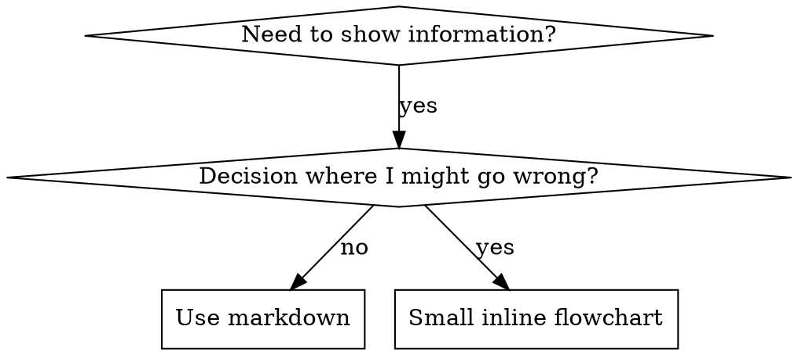

<!-- Generated from .agents/skills/skill-authoring/SKILL.md; edit the canonical source, then run node .claude/core/render-shared-agents.js. -->

# Skill Authoring

## Overview

Skill authoring is evidence-driven: prove the gap, then prove the skill closes it.

A skill, new or edited, is justified by evidence of a real gap first and a differential eval after. The gap is the empirical baseline: an agent that fails the task without the skill, a recorded misalignment (an `agent-updates` entry), a repeated gate failure, or a cluster of memories showing agents keep re-deriving the same thing unaided. Draft the skill, then measure the difference it makes (`with_skill` vs `without_skill` or `old_skill`) and keep it only if it measurably helps.

Do not add skill content for a gap you cannot point to, and do not claim a skill helps without a differential that shows it. Evidence bookends the work; it need not come before the first word is written.

> **Doctrine note (2026-06-06):** This replaces the old "no skill without a failing test first" Iron Law. Pre-emptive pressure-testing blocked machine-assisted skill generation (no baseline can run before a skill exists when it is synthesized from accumulated workflows) and diverged from Anthropic's `skill-creator`, where tests come after the draft. Full rationale: `docs/architecture/decisions/0003-self-improving-skills.md`.

For the create, eval, improve and benchmark loop, the eval harness, the differential workspace layout and description optimization, use `skill-creator`. This skill owns the doctrine and conventions; `skill-creator` owns the mechanics. The autonomous driver that mines this repo's signals into skill work is `/review:evolve-skills`.

Anthropic's official authoring best practices: `references/anthropic-best-practices.md`.

## What is a Skill?

A skill is a reference guide for proven techniques, patterns or tools that helps future Claude instances find and apply effective approaches. Skills are reusable techniques, patterns, tools and reference guides, not narratives about how you solved a problem once.

## TDD Mapping for Skills

| TDD Concept | Skill Creation |
|-------------|----------------|
| **Test case** | Pressure scenario with subagent |
| **Production code** | Skill document (SKILL.md) |
| **Test fails (RED)** | Agent violates rule without skill (baseline) |
| **Test passes (GREEN)** | Agent complies with skill present |
| **Refactor** | Close loopholes while maintaining compliance |
| **Establish baseline** | Capture the failure without the skill — a run, a recorded `agent-updates` misalignment, or a memory cluster (capturing it *after* the draft is fine) |
| **Watch it fail** | Document exact rationalizations / the gap the agent shows |
| **Minimal code** | Write skill addressing those specific violations |
| **Watch it pass** | Verify the differential: `with_skill` beats baseline |
| **Refactor cycle** | Find new rationalizations → plug → re-verify |

The cycle keeps TDD's spirit, with one change: the baseline and eval bookend the draft rather than strictly preceding it (see The Law below). Mechanics: `skill-creator`.

## When to Create a Skill

**Create when:**
- Technique wasn't intuitively obvious to you
- You'd reference this again across projects
- Pattern applies broadly (not project-specific)
- Others would benefit

**Don't create for:**
- One-off solutions
- Standard practices well-documented elsewhere
- Project-specific conventions (put in CLAUDE.md)
- Mechanical constraints (if it's enforceable with regex/validation, automate it—save documentation for judgment calls)

## Skill Types

### Technique
Concrete method with steps to follow (condition-based-waiting, root-cause-tracing)

### Pattern
Way of thinking about problems (flatten-with-flags, test-invariants)

### Reference
API docs, syntax guides, tool documentation (office docs)

## Directory Structure


```
skills/
  skill-name/
    SKILL.md              # Main reference (required)
    supporting-file.*     # Only if needed
```

All skills share one flat, searchable namespace.

Separate files for heavy reference (100+ lines: API docs, comprehensive syntax) and reusable tools (scripts, utilities, templates). Keep principles, concepts, code patterns under 50 lines and everything else inline.

## SKILL.md Structure

**Frontmatter (YAML):** five required fields, shown in the template below.
- `name`: letters, numbers and hyphens only (no parentheses or special characters)
- `description`: third person. It may lead with a brief what-it-does clause but must state when to use the skill (the Agent Skills open spec allows both; at most 1024 characters, ideally under 500).
  - Keep the "Use WHEN..." triggering conditions, even when a what-clause is present
  - Include specific symptoms, situations and contexts
  - Do not summarize the skill's step-by-step process: naming what it covers is fine, but describing how it works lets Claude shortcut and skip the body (see CSO)
- `metadata`: `version`, `author`, `tags`
- `user-invocable`: `false` unless the skill is a slash command (rare)
- `allowed-tools`: Whitelist matching the skill's actual write surface

```markdown
---
name: skill-name-with-hyphens
description: "[Brief what-it-does clause — optional]. Use WHEN [specific triggering conditions and symptoms]. Triggers: keyword1, keyword2"
metadata:
  version: 1.0.0
  author: Domdhi.Agents
  tags: [tag1, tag2]
user-invocable: false
allowed-tools: Read Write Edit Grep Glob
---

# Skill Name

## Overview
What is this? Core principle in 1-2 sentences.

## When to Use
[Small inline flowchart IF decision non-obvious]

Bullet list with symptoms and use cases
When NOT to use

## Core Pattern (for techniques/patterns)
Before/after code comparison

## Quick Reference
Table or bullets for scanning common operations

## Implementation
Inline code for simple patterns
Link to file for heavy reference or reusable tools

## Common Mistakes
What goes wrong + fixes

## Real-World Impact (optional)
Concrete results
```


## Claude Search Optimization (CSO)

Future Claude needs to find the skill.

### 1. Rich Description Field

Claude reads the description to decide which skills to load, so it should answer "Should I read this skill right now?" Start with "Use when..." and state triggering conditions only. Do not summarize the skill's process or workflow.

When a description summarizes the workflow, Claude may follow the description instead of reading the body. A description saying "code review between tasks" caused one review even though the skill's flowchart showed two (spec compliance, then code quality). Changed to "Use when executing implementation plans with independent tasks", Claude read the flowchart and ran both reviews. A workflow summary becomes a shortcut, and the body becomes documentation Claude skips.

```yaml
# ❌ BAD: Summarizes workflow - Claude may follow this instead of reading skill
description: Use when executing plans - dispatches subagent per task with code review between tasks

# ❌ BAD: Too much process detail
description: Use for TDD - write test first, watch it fail, write minimal code, refactor

# ✅ GOOD: Just triggering conditions, no workflow summary
description: Use when executing implementation plans with independent tasks in the current session

# ✅ GOOD: Triggering conditions only
description: Use when implementing any feature or bugfix, before writing implementation code
```

**Content:**
- Use concrete triggers, symptoms and situations that signal the skill applies
- Describe the problem (race conditions, inconsistent behavior), not language-specific symptoms (setTimeout, sleep)
- Keep triggers technology-agnostic unless the skill itself is technology-specific, and then say so in the trigger
- Write in third person (the description is injected into the system prompt)

```yaml
# ❌ BAD: Too abstract, vague, doesn't include when to use
description: For async testing

# ❌ BAD: First person
description: I can help you with async tests when they're flaky

# ❌ BAD: Mentions technology but skill isn't specific to it
description: Use when tests use setTimeout/sleep and are flaky

# ✅ GOOD: Starts with "Use when", describes problem, no workflow
description: Use when tests have race conditions, timing dependencies, or pass/fail inconsistently

# ✅ GOOD: Technology-specific skill with explicit trigger
description: Use when using React Router and handling authentication redirects
```

### 2. Keyword Coverage

Use words Claude would search for:
- Error messages: "Hook timed out", "ENOTEMPTY", "race condition"
- Symptoms: "flaky", "hanging", "zombie", "pollution"
- Synonyms: "timeout/hang/freeze", "cleanup/teardown/afterEach"
- Tools: Actual commands, library names, file types

### 3. Descriptive Naming

Use active voice, verb-first: `creating-skills` not `skill-creation`; `condition-based-waiting` not `async-test-helpers`.

### 4. Token Efficiency (Critical)

**Problem:** getting-started and frequently referenced skills load into every conversation, so every token counts.

**Target word counts:**
- getting-started workflows: <150 words each
- Frequently-loaded skills: <200 words total
- Other skills: <500 words (still be concise)

**Techniques:**

**Move details to tool help:**
```bash
# ❌ BAD: Document all flags in SKILL.md
search-conversations supports --text, --both, --after DATE, --before DATE, --limit N

# ✅ GOOD: Reference --help
search-conversations supports multiple modes and filters. Run --help for details.
```

**Use cross-references:**
```markdown
# ❌ BAD: Repeat workflow details
When searching, dispatch subagent with template...
[20 lines of repeated instructions]

# ✅ GOOD: Reference other skill
Use subagents (50-100x context savings). Required: use [other-skill-name] for workflow.
```

**Compress examples:** a 20-word example (`Partner: "How did we handle auth errors in React Router?"` / `You: Searching...` / `[Dispatch subagent → synthesis]`) beats the 42-word version of the same exchange.

**Eliminate redundancy:**
- Don't repeat what's in cross-referenced skills
- Don't explain what's obvious from the command
- Don't include multiple examples of the same pattern

**Verification:**
```bash
wc -w skills/path/SKILL.md
# getting-started workflows: aim for <150 each
# Other frequently-loaded: aim for <200 total
```

**Name by what you do or the core insight:** `condition-based-waiting` over `async-test-helpers`, `flatten-with-flags` over `data-structure-refactoring`, `root-cause-tracing` over `debugging-techniques`. Gerunds (`creating-skills`, `testing-skills`) work well for processes.

### 4. Cross-Referencing Other Skills

Reference other skills by name only, with explicit requirement markers:
- ✅ Good: `**REQUIRED SUB-SKILL:** systematic-debugging` (local skill name, no namespace prefix)
- ✅ Good: `**REQUIRED BACKGROUND:** verification-before-completion`
- ❌ Bad: `See skills/testing/test-driven-development` (unclear if required)
- ❌ Bad: `@skills/testing/test-driven-development/SKILL.md` (force-loads, burns context)
- ❌ Bad: `superpowers:test-driven-development` (`superpowers:*` is from an external library, not this repo)

`@` links force-load files immediately, consuming 200k+ context before you need them.

A workflow that may be absent under a lean skill profile (`.agents/adapters/skill-profiles.json`) is named with "if installed" on the same line, e.g. ``Run `/review:feedback` if installed.`` The profile closure check treats such a line as optional; an unmarked invocation of a skill a profile drops fails `skill-profiles-live.test.js`.

## Flowchart Usage



**Use flowcharts only for:**
- Non-obvious decision points
- Process loops where you might stop too early
- "When to use A vs B" decisions

**Do not use flowcharts for:**
- Reference material → Tables, lists
- Code examples → Markdown blocks
- Linear instructions → Numbered lists
- Labels without semantic meaning (step1, helper2)

See `.agents/skills/skill-authoring/references/graphviz-conventions.dot` for graphviz style rules.

**Visualizing for your human partner:** Use `scripts/render-graphs.js` (in the skill directory) to render a skill's flowcharts to SVG:
```bash
./scripts/render-graphs.js ../some-skill           # Each diagram separately
./scripts/render-graphs.js ../some-skill --combine # All diagrams in one SVG
```

## Code Examples

One excellent example beats many mediocre ones. Choose the most relevant language:
- Testing techniques → TypeScript/JavaScript
- System debugging → Shell/Python
- Data processing → Python

A good example is complete and runnable, commented to explain why, drawn from a real scenario, and ready to adapt. Do not implement in 5+ languages, write fill-in-the-blank templates or contrive examples.

One great example is enough; Claude ports it.

## File Organization

- **Self-contained** (`defense-in-depth/SKILL.md`): all content fits inline, no heavy reference.
- **With a reusable tool** (`condition-based-waiting/` with `SKILL.md` + `example.ts`): the tool is reusable code, not just narrative.
- **With heavy reference** (`pptx/` with `SKILL.md`, `pptxgenjs.md` at 600 lines, `ooxml.md` at 500 lines, `scripts/`): reference material too large for inline.

## Toolkit Skill Archetypes & Wiring

A skill in this toolkit is one of two shapes, and the `Overview / When to Use / Core Pattern` skeleton above is only one of them:

- **Doc-producer** — owns a domain-doc template in `assets/` (e.g. `assets/spec.md` → `docs/design/spec.md`, `assets/backlog.md` → `docs/work/backlog.md`; wired into `scaffold.js`'s `SKILL_TEMPLATE_MANIFEST`) and validates the artifact it produces. Use a `Document Template (one-line pointer to assets/) / Required Sections Checklist / Quality Criteria / Interview Questions` skeleton. The `assets/` copy is the scaffold source of record (raw, with the `<!-- @@template -->` first line), so the skill and `scaffold.js` share one copy.
- **Technique / prose** — encodes a method or voice, owns no scaffolded template. Use the `Overview / When to Use / Core Pattern` skeleton above. Examples: this skill, `systematic-debugging`, the design-technique skills (`design-taste-frontend`, `tailwind-css-patterns`), `ghostwriting`.

When in doubt, ask "does this skill own a scaffolded domain-doc template (in `assets/`, wired into `SKILL_TEMPLATE_MANIFEST`)?" Yes → doc-producer; No → technique/prose.

**Where the planning-pipeline doc-producers live:** the planning *text* documents are consolidated into **one** skill, **`project-planning`** (brief, requirements, feature-ideas, epics/stories backlog, and the project-context quick-ref — each its own `references/` guide + `assets/` template). It is not one skill per document and there is no `-writer` suffix convention. The genuine design disciplines — **`architecture`** and **`ux-design`** — stay self-contained (each owns its own template *and* its craft knowledge), because they carry real domain judgment beyond producing a doc.

**Wiring checklist (new skill):**
- [ ] Directory at `.agents/skills/{name}/SKILL.md`, `name:` field matches the directory
- [ ] At least one agent lists it in frontmatter `skills:` — OR it's loaded directly by a command via `Read` (both valid)
- [ ] Content is domain knowledge, not orchestration (orchestration belongs in commands)
- [ ] No duplication of content already in another skill
- [ ] `description` leads with what-it-does + keeps the "Use WHEN…" triggering clause (CSO) — never a workflow summary
- [ ] If a doc-producer: template lives in `assets/` (raw, marker on line 1) and is registered in `SKILL_TEMPLATE_MANIFEST`

## Project additions to a template skill

Skills are Template zone: `template-updater`/`fleet:sync` overwrites them in every
adopter. Project-specific content added to a template skill goes inside one of two
sentinel forms (never edit template-owned prose in place) or it is clobbered on the
next sync: a whole-tail `<!-- @@project-additions -->` marker for a new section appended
at EOF, or an anchored `<!-- @@project-additions:start -->`/`:end` fence for a bullet
inserted inside an existing section (the whole-tail marker can't protect that shape).
Both are matched only outside documentation code fences. Full doctrine, examples, the
`fleet:diverge` interaction, and a live bug this fixed:
`references/project-additions-marker.md`.

## The Law (evidence bookends the work)

```
NO SKILL CONTENT WITHOUT EVIDENCE OF A GAP — AND A DIFFERENTIAL THAT SHOWS IT CLOSES
```

This applies to new skills and to edits of existing skills. The order is evidence, then draft, then differential eval.

- **Evidence of a gap (the baseline):** a `without_skill` / `old_skill` run that fails, an `agent-updates` misalignment, a repeated gate failure, or a cluster of memories showing agents keep re-deriving this unaided. No gap you can point to means no skill content; speculative "this could be clearer" polish is out of scope.
- **Differential (the proof):** `with_skill` measurably beats the baseline on pass-rate: `node .claude/core/skill-eval.js aggregate <iteration> --skill-name <name>`. A delta ≤ 0 means the change is not earning its place; iterate or drop it.

The evidence requirement has no exceptions, but it can be lightweight. A "simple addition", "just a section" or doc update still needs a gap behind it, which can be one recorded misalignment with a single with/without spot-check as the differential. Subjective skills (writing style, design taste) are judged qualitatively; human judgment is the differential there.

Load `references/testing-methodology.md` for full testing detail by skill type, rationalization tables, bulletproofing patterns, and the RED-GREEN-REFACTOR process for skills. Load when writing or pressure-testing a new skill.

## Anti-Patterns

- Narrative examples ("In session 2025-10-03, we found..."): too specific to reuse.
- Multi-language examples (example-js.js, example-py.py, example-go.go): mediocre quality and a maintenance burden.
- Code in flowcharts (`step1 [label="import fs"]`): cannot be copy-pasted and is hard to read.
- Generic labels (helper1, step3, pattern4): labels need semantic meaning.

## Discovery Workflow

How future Claude finds your skill:

1. Encounters a problem ("tests are flaky")
2. Finds the skill (description matches)
3. Scans the overview (is this relevant?)
4. Reads patterns (quick reference table)
5. Loads an example (only when implementing)

Put searchable terms early and often.

## The Bottom Line

Prove the gap (baseline), draft the skill, prove it closes the gap (differential), then refactor to generalize. The ordering is relaxed from TDD so skills can be drafted, including machine-generated from accumulated experience, before the eval validates them. Use `skill-creator` to run the loop and `/review:evolve-skills` to automate it.
