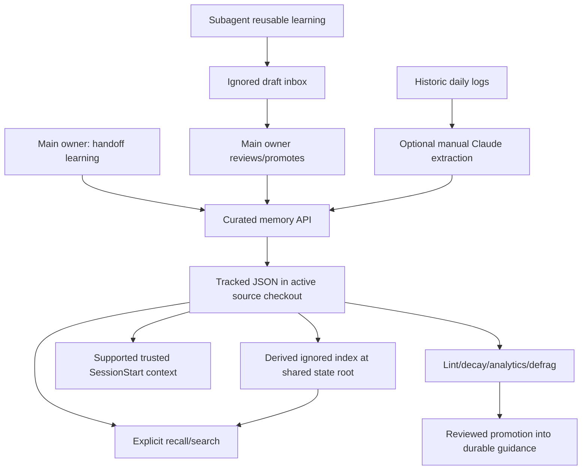

# Memory Flow

The current acquisition, recall and maintenance paths share one curated JSON source. [Memory](concepts/memory.md) explains ranking and lifecycle; [the native context contract](../../../.agents/adapters/codex/README.md#context-contract) owns root/override details.

## Writes

| Author/path | Trigger | Destination and boundary |
| --- | --- | --- |
| Main owner | Session-handoff learning | Curated JSON through memory-manager; record reusable learning, not progress |
| Subagent | Reusable discovery | Ignored inbox draft; main owner decides promotion/discard |
| Legacy native Claude agent memory | Native memory plus explicit ingest | Native Markdown does not automatically enter the curated store; manual bridge retains compatibility |
| Historic extraction | Explicit Claude text-only backfill | Daily log to curated candidates; inference failure remains a failure, not completed extraction |

Codex optional memory inference is unavailable and automatic Stop extraction is unregistered. Main-owner curated acquisition and explicit helpers remain supported. ADR 0001 (memory unification, kept in the workshop) explains the acquisition boundary.

## Reads and storage

Tracked JSON belongs to the active source checkout; the ignored index, inbox and daily logs share the main-worktree state root. `AGENT_SHARED_STATE_ROOT` overrides state separately. Neutral/Codex source overrides and the legacy direct-Claude exception follow the linked context contract. A per-worktree source checkout does not imply a separate per-worktree index.

Startup context requires installed trusted runtime hooks and actual observed injection. Explicit recall before domain work follows returned search rank and deduplicates memory already visible/read. Claude's native context envelope and Codex's additionalContext conversion differ; discovery does not prove either execution path.

## Categories and maintenance

The five categories are patterns, constraints, decisions, workflows and rejected approaches. Decay rates/thresholds come from `MEMORY_DECAY`; capacity and warning/prune triggers come from `MEMORY_FILTERS.MEMORY_MAX_PER_CATEGORY` and `MEMORY_FILTERS.MEMORY_NEAR_LIMIT_PCT` in [constants.js](../../../.agents/core/constants.js). Consumers apply the documented environment overrides. Avoid copying literal caps/rates into this diagram.

Confidence, intrinsic importance, supersession and genuine retrieval usage have distinct meanings. Empty authoritative sources and incomplete/corrupt snapshots need different repair results. Lint/age warnings do not by themselves justify deleting memory or rewriting historical evidence.

## Source signposts

- [memory-manager.js](../../../.agents/core/memory-manager.js): curated APIs, optional index and repair.
- [memory paths](../../../.agents/core/_lib/memory-paths.js) and [root resolver](../../../.agents/core/_lib/project-root.js): source/shared state.
- [SessionStart handler](../../../.agents/hooks/session-start-prime.cjs): injection and index repair.
- [session-handoff skill](../../../.agents/skills/session-handoff/SKILL.md): main-owner acquisition.
- [Codex adapter](../../../.agents/adapters/codex/README.md): registered behavior and inference/trust limits.
- Memory parity research (2026-06-20, kept in the workshop): retained bridge evidence.
