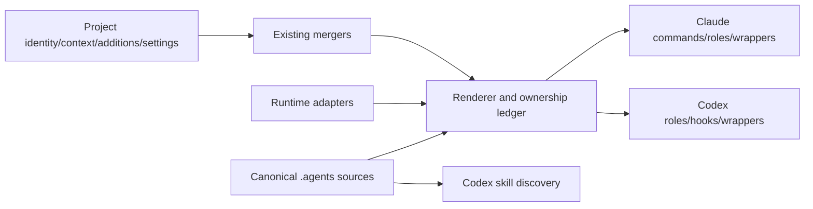

# Domdhi.Agents — System Map

The toolkit has 50 workflows, 11 shared roles and 24 knowledge skills. [Commands](commands.md) is the complete workflow inventory with both native names and procedure links; [skills](concepts/skills.md) owns the knowledge catalog. This map shows source/delivery wiring and runtime responsibilities without duplicating their procedures.

## Source and delivery

| Surface | Authored source | Delivered entry point |
| --- | --- | --- |
| Workflow | `.agents/skills/{name}/references/workflow.md` (specialize uses SKILL.md) | Claude generated command; Codex discovered canonical skill |
| Knowledge/assets | `.agents/skills/{name}/` | Claude generated skill; Codex canonical skill |
| Role persona/skills | `.agents/roles/{name}.md` | `.claude/agents/{name}.md`, `.codex/agents/{name}.toml` |
| Runtime model/tools/protocol | `.agents/adapters/{runtime}/` (tier maps in `model-tiers.json`) | Native metadata/hooks/role settings; project overrides preserved |
| Executable helpers/hooks | `.agents/core/`, `.agents/hooks/` | Native `.claude/core/`, `.codex/core/` and hook wrappers |
| Templates | Skill assets plus `.agents/templates/` | Scaffold's existing manifest/native-compatible paths |
| Version | `.agents/config/version.json` | Rendered `.claude/version.json` |
| Ownership state | `.agents/render-state.json` | Source/projection hashes; retained with canonical/native delivery |
| Root policy | `.agents/startup.md`, conditional startup-reference | Managed directives inside project-owned CLAUDE/AGENTS prose |

Shared sources and runtime adapters are authored once. Rendered edits must be reconciled into their actual source before rendering. [Customization](customization.md) describes merge boundaries and local overrides.

## Shared roles and knowledge wiring

| Role | Declared knowledge skills | Source |
| --- | --- | --- |
| `architect` | architecture, verification-before-completion | [Role](../../../.agents/roles/architect.md) |
| `code-reviewer` | code-review | [Role](../../../.agents/roles/code-reviewer.md) |
| `doc-writer` | project-planning, documentation, verification-before-completion | [Role](../../../.agents/roles/doc-writer.md) |
| `general-purpose` | full-output-enforcement, systematic-debugging, verification-before-completion, finishing-a-development-branch, using-git-worktrees | [Role](../../../.agents/roles/general-purpose.md) |
| `playwright` | playwright-cli, verification-before-completion | [Role](../../../.agents/roles/playwright.md) |
| `product-strategist` | project-planning, verification-before-completion | [Role](../../../.agents/roles/product-strategist.md) |
| `project-planner` | project-planning, verification-before-completion | [Role](../../../.agents/roles/project-planner.md) |
| `qa-engineer` | qa-engineer, verification-before-completion | [Role](../../../.agents/roles/qa-engineer.md) |
| `security-auditor` | code-review | [Role](../../../.agents/roles/security-auditor.md) |
| `shadow` | ghostwriting, content-formats | [Role](../../../.agents/roles/shadow.md) |
| `ux-designer` | ux-design, brand-guidelines, verification-before-completion | [Role](../../../.agents/roles/ux-designer.md) |

Roles declare a model tier (`standard`, `deep`, `audit`, `fast`) in each adapter's `shared-agents.json`; the adapter's `model-tiers.json` maps each tier to a native model, and tokenized prose in workflows and roles renders from the same map. Claude's `standard` tier is Sonnet, so its ordinary role floor is Sonnet; security-auditor is pinned Opus and routing policy escalates selected high-stakes calls. Codex uses its configured model and native dispatcher. Read [agents](concepts/agents.md) for roles, limitations and selection. Claude's built-in Explore is not a twelfth authored toolkit role. Project specialization can add canonical roles and skills.

## Helpers by purpose

Implementations live in `.agents/core/`. Run native helpers through the active runtime prefix—`.claude/core/` in Claude and `.codex/core/` in Codex. Direct shared execution must explicitly select its runtime. This table lists important seams, not a second complete file manifest.

| Helper/group | Responsibility |
| --- | --- |
| `install.js`, `template-updater.js` | Validated ordinary install/update, source filtering and existing preservation mergers |
| `render-shared-agents.js`, `_lib/shared-agents.js` | Native projection, source dependencies and ownership hashes |
| `runtime-context.js`, `_lib/project-root.js`, `_lib/memory-paths.js` | Installed assets, source checkout and ignored shared-state roots |
| `gate.js`, `commit.js` | Application/toolkit gate routing and staged secret-scanned commits |
| `build-lock-recovery.js`, `_lib/owned-process-tree.js` | Gate lock recovery: evidence for stale build/test locks and, on Windows, owned process-tree leases. See [gate lock recovery](gate-lock-recovery.md) |
| `learning-intake.js`, `learning-intake-github.js` | Project-owned learning-intake identity, policy and authorized delivery. See the [learning intake guide](guides/learning-intake.md) |
| `uninstall.js` | Reviewed, approval-bound removal of unchanged template files recorded in the render ledger; edited, unlisted and linked files are kept |
| `context-audit.js` | Read-only inventory of instruction-file sizes with optional baseline and per-file budget comparison |
| `status.js`, `gen-timeline.js`, `handoff-path.js` | TODO dashboards, timeline and continuity paths |
| `memory-manager.js`, `memory-health-check.js`, `_lib/memory-index-divergence.js` | Curated JSON, optional SQLite index, repair/health and recall |
| `memory-extractor.js`, `memory-curator.js`, `memory-benchmark.js` | Optional text-only inference utilities: Claude Sonnet backend; Codex inference unavailable |
| `memory-promoter.js`, `memory-eval.js`, `_lib/memory-lint.js`, `memory-backup.js` | Durable guidance promotion, evaluation, lint and backup |
| `skill-conformance.js`, `skill-resolution.js`, `skill-eval.js`, `skill-evolution.js` | Skill structure/wiring and differential evolution |
| `_lib/doc-drift.js`, `adr-lint.js`, `path-drift-lint.js`, `fs-safe-lint.js` | Document/ADR/path/write-boundary integrity checks |
| `telemetry-log.js`, `metrics.js`, `feedback-digest.js`, `guardrail-stats.js` | Recorded command/gate/hook activity and feedback |
| `branch-audit.js`, worktree hook | Read-only branch audit and guarded sibling worktree lifecycle |

Legacy memory compilation remains compatibility behavior, not the prescribed acquisition path. See [memory](concepts/memory.md) and [memory flow](memory-flow.md) for the current pipeline.

## Hook and runtime boundaries

[Hooks](concepts/hooks.md) contains the 16-handler Claude inventory and links the smaller Codex event/tool adaptation. Shared handlers run through generated native wrappers. The Codex adapter also registers a `SubagentStop` hook (`.agents/hooks/subagent-stop.cjs`) that records completion-sourced dispatch telemetry, and rendering writes `.codex/hook-identities.json` so installed registrations can be compared before trust. Trust, discovery, executed handlers and fresh-session model-visible behavior are separate evidence. Plain terminal commands and some hosted tools bypass hooks; commit scanning belongs to the commit helper. Codex optional memory inference and automatic Stop extraction are unavailable.

The [Codex adapter context contract](../../../.agents/adapters/codex/README.md#context-contract) defines source override precedence, worktree/common-state behavior and installed-asset resolution. Do not resolve all three roots from invocation cwd or assume a hook child's runtime selects the parent helper runtime.

## Delivery and tests

Install/update deliver the shared/native toolkit and preserve project content; reference documentation reaches readers through this workshop or the publish artifact only. Workshop `tools/publish.js` selects tracked allowlisted files and prepares the independent nested `_Domdhi.Agents/` storefront. `tools/fleet.js` coordinates authorized release/sync operations. Local metadata preparation, publication and adopter rollout are distinct actions—see [migration v6](migration-v6.md).

Shared tests colocate under `.agents/**/__tests__/`; runtime-specific suites colocate with adapters and delivery tests under `tools/__tests__/`. Toolkit gates run only here. Adopter gates run the application, including after agent updates. Coverage measures canonical implementations rather than generated wrappers.

[Docs index](../../README.md) gives newcomer/adopter/contributor routes. [Contributing](guides/contributing.md) explains additions; [customization](customization.md) explains preservation.
